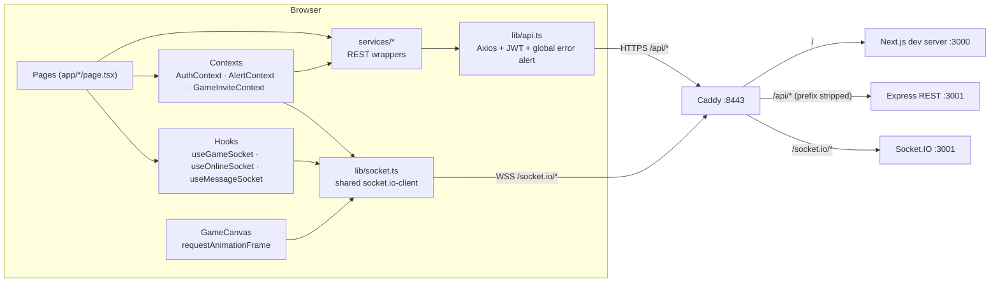
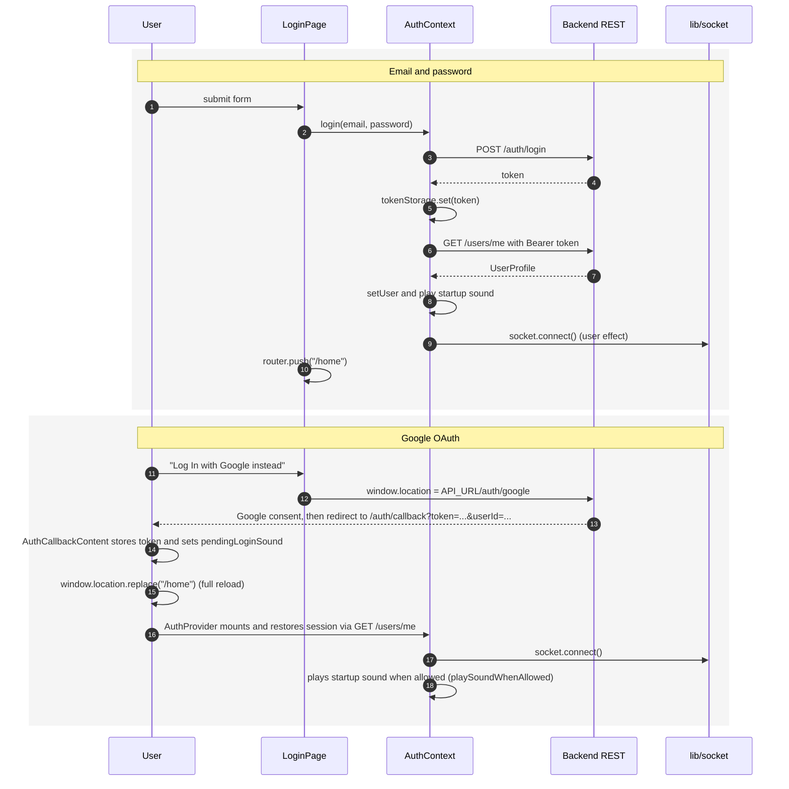
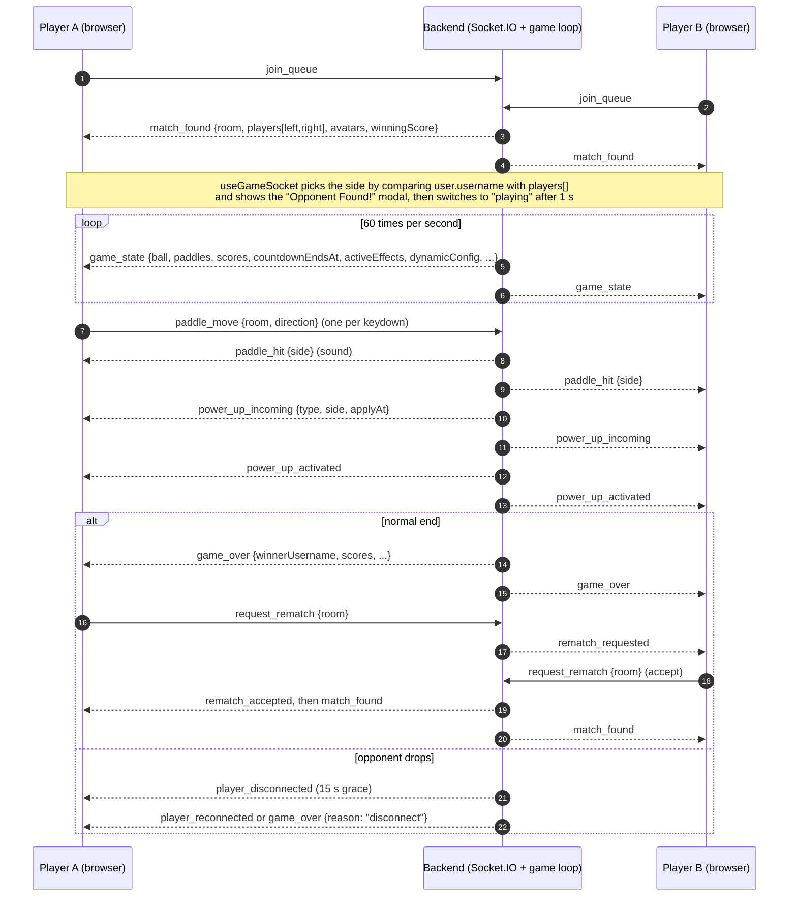
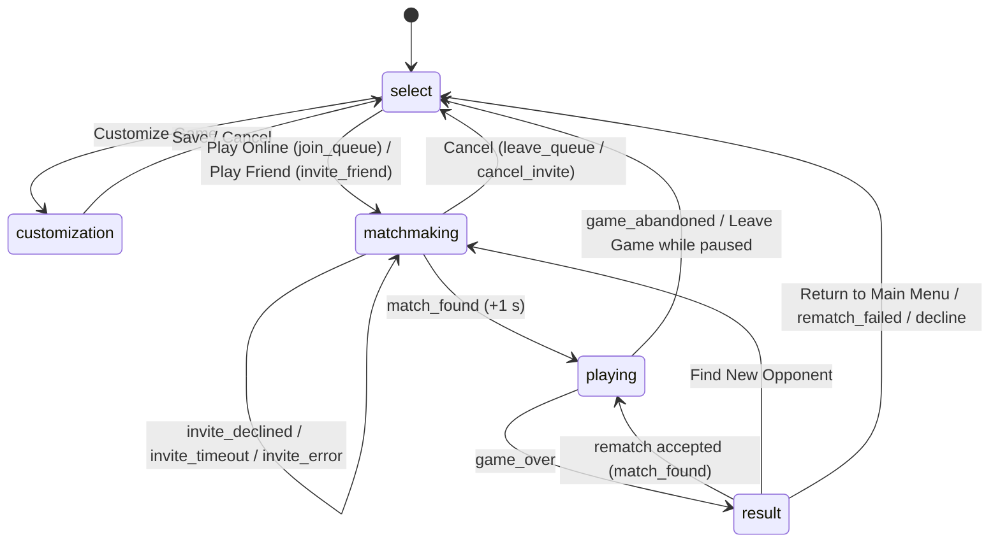
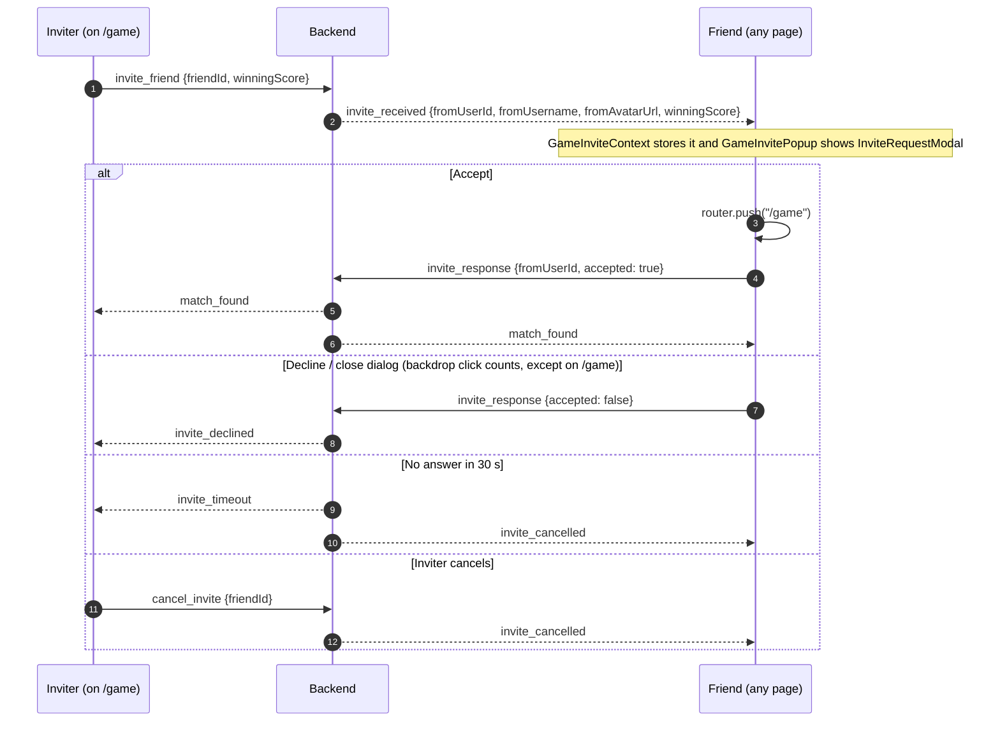
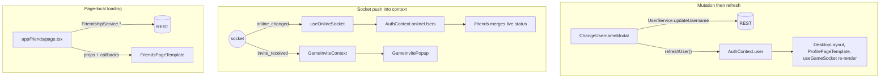

# PONG_XP Frontend: Walkthrough and Defense Guide

This guide is for the person who presents and defends the frontend in [`frontend/`](frontend/). It covers what the code does, why it was built this way, and where each piece lives, so that you can explain it in your own words, answer an evaluator's questions and change something live without searching. Everything here was checked against the source code, not plans.

How to use it:

- **Before the evaluation:** read [Presenting this frontend](#presenting-this-frontend) and [§17 Questions to expect](#17-questions-to-expect). Together they are the short version.
- **To understand a part:** use §1–§13. Each section names the files involved, so open them next to the text.
- **To prepare for "what would you improve?":** read [§16](#16-known-limitations-and-technical-notes). Knowing the weak points and having an answer ready is better than being caught out.

Related documents in the repository root:

- [`README.md`](README.md): product overview, full-stack setup, modules, database schema.
- [`SOCKET_EVENTS.md`](SOCKET_EVENTS.md): the authoritative Socket.IO event contract between frontend and backend.
- [`STYLING_NOTES.md`](STYLING_NOTES.md): design-token pipeline and design-system inventory.
- Swagger UI at `https://localhost:8443/api/api-docs` (when the stack is running): the REST contract.

---

## Table of contents

1. [Overview](#1-overview)
2. [Technology Stack](#2-technology-stack)
3. [Project Structure](#3-project-structure)
4. [Application Routing](#4-application-routing)
5. [Component Architecture](#5-component-architecture)
6. [Styling and UI Design](#6-styling-and-ui-design)
7. [Authentication and User State](#7-authentication-and-user-state)
8. [Backend Communication](#8-backend-communication)
9. [Real-Time Communication](#9-real-time-communication)
10. [Game Interface](#10-game-interface)
11. [Major Features](#11-major-features)
12. [State Management and Data Flow](#12-state-management-and-data-flow)
13. [Error Handling and Loading States](#13-error-handling-and-loading-states)
14. [Environment Setup](#14-environment-setup)
15. [Adding New Features](#15-adding-new-features)
16. [Known Limitations and Technical Notes](#16-known-limitations-and-technical-notes)
17. [Questions to Expect](#17-questions-to-expect)

---

## Presenting this frontend

### The one-minute version

> PONG_XP is real-time online Pong inside a Windows XP desktop. The frontend is a Next.js 16 / React 19 app where every page is a client component. It talks to the backend in two ways: REST through one Axios instance for data (auth, profiles, friends, chat history, stats), and one shared Socket.IO connection for anything live (presence, invites, matchmaking, the game itself, chat delivery). The game is server-authoritative: the browser only sends "up" or "down" and draws the frames the server sends 60 times a second on a canvas. Styling is a token-based design system: SCSS for the XP look, Tailwind for layout, with a script that keeps the two in sync. The layout is responsive down to phones, where the desktop turns into an icon grid with a maximised window and the game can be played by touch.

### Suggested demo order

Use two browsers (or one normal and one private window) logged in as different users, A and B.

1. **Landing and auth** (`/`, `/login`, `/register`). Mention the client-side route guard (`AuthRedirect`) and Google OAuth (`/auth/callback`). See [§7](#7-authentication-and-user-state).
2. **Desktop shell** (`/home`). Sidebar, floating icons, Start menu, taskbar clock and the wallpaper picker. Point out that every icon comes from data in `app/data/navigationItems/`. Shrink the browser window to show the phone layout. See [§5](#desktop-shell) and [§6](#responsive-behaviour).
3. **Friends** (`/friends`). A searches for B and sends a request; B accepts. Show the green status dot change live when one of them logs out. See [§11](#friends-friends).
4. **Chat** (`/chats`). A writes to B; the message appears instantly for A (optimistic) and is pushed to B by the socket. Point out the unread badge when B has another conversation open. See [§11](#chat-chats).
5. **Game invite.** A opens `/game` → Play Friend → picks B and a max score. B gets the invite popup on whatever page they are on. See [§11](#game-invitations).
6. **Match.** Play a few points, show a power-up, then close one tab mid-game to show the 15 s reconnection grace. Finish with a rematch. See [§10](#10-game-interface).
7. **Stats** (`/gameStats`). Match history with the Recharts chart and the leaderboard with the All/Friends switch.
8. **Code tour.** `app/layout.tsx` (providers) → `lib/api.ts` and `lib/socket.ts` (the two channels) → `hooks/UseGameSockets.tsx` (game state machine) → `GameCanvas.tsx` (rendering and input).

### Design decisions and how to justify them

| Decision | Why it was done this way |
| --- | --- |
| Every page is a client component | All data comes from a separate Express backend at runtime and the UI is heavily interactive (sockets, canvas, modals). Server components would add a second data path for no gain. |
| The server is authoritative for the game | Prevents cheating (a client cannot move the ball or change the score) and keeps both players in sync because both draw the same state. |
| Game frames go into a ref, not React state | 60 updates per second through `setState` would re-render the whole page 60 times a second. The canvas reads the ref inside a `requestAnimationFrame` loop instead. |
| One shared socket, connected by `AuthContext` | Presence and invites must work on every page, so the connection follows the login state, not a page. One connection also means one presence entry per tab on the server. |
| The socket token is read through an `auth` callback | The token is read again on every (re)connect, so logging out and in as someone else uses the new token without recreating the socket. |
| One Axios instance with interceptors | The JWT header and error display are written once. Any call made through `api` automatically gets both. |
| Errors are shown globally by the interceptor | Users always see why a request failed, and pages do not repeat the same `catch` code. The cost is that pages must not show a second alert for the same error. |
| Page/template split | Pages load data and handle mutations; templates only lay things out from props. This keeps components reusable (`FriendListPanel` serves both Friends and Chats). |
| Design tokens in SCSS, mapped into Tailwind | One source of truth for colours and sizes. Tailwind's default palette is removed, so off-brand classes like `bg-red-500` do not compile, and a script fails the check if a token is not mapped. |
| Custom Tailwind variants (`compact`, `roomy`, `game-stacked`) | The breakpoints that matter depend on both width and height (a phone in landscape is wide but short). Named variants keep those media queries in one place in `tailwind.css`. |
| Game modals cannot be closed by clicking the backdrop | A stray click during matchmaking or after a game would cancel a search or decline a rematch by accident. They close only through their own buttons. |

### Files to know by heart

| If asked about... | Open |
| --- | --- |
| How the app starts and what wraps every page | [`app/layout.tsx`](frontend/app/layout.tsx) |
| Login state, session restore, socket connect | [`context/AuthContext.tsx`](frontend/context/AuthContext.tsx) |
| Route protection | [`app/auth/authRedirect/AuthRedirect.tsx`](frontend/app/auth/authRedirect/AuthRedirect.tsx) |
| REST and error handling | [`lib/api.ts`](frontend/lib/api.ts), [`services/`](frontend/services/) |
| Socket setup | [`lib/socket.ts`](frontend/lib/socket.ts) |
| Game logic on the client | [`hooks/UseGameSockets.tsx`](frontend/hooks/UseGameSockets.tsx) |
| Drawing and paddle input | [`app/components/game/GameCanvas.tsx`](frontend/app/components/game/GameCanvas.tsx) |
| Game types and rules shared with the backend | [`types/game_types.ts`](frontend/types/game_types.ts) |
| Invites on any page | [`context/GameInviteContext.tsx`](frontend/context/GameInviteContext.tsx), [`GameInvitePopup.tsx`](frontend/app/components/GameInvitePopup/GameInvitePopup.tsx) |
| Styling system | [`app/styles/_tokens.scss`](frontend/app/styles/_tokens.scss), [`app/tailwind.css`](frontend/app/tailwind.css) |

---

## 1. Overview

The frontend is a Next.js App Router application that presents the whole product as a **Windows XP desktop**: a wallpaper, a column of desktop icons, a taskbar with a Start menu and clock, and "windows" for each feature (profile, friends, chats, stats, paint, legal pages). The Pong game runs on its own full-screen page.

### Architectural approach

- **Client-rendered app.** Every page and context is a client component (`"use client"`). Next.js provides routing, bundling, fonts and image optimisation; there are no server components that fetch data, no route handlers, no middleware and no server actions. All data comes from the Express backend at runtime.
- **The server is authoritative for the game.** The backend runs ball physics, collisions, scoring, power-ups and timers. The frontend only sends paddle input (`paddle_move`) and draws the `game_state` frames it receives on an HTML5 canvas.
- **Two channels to the backend:**
  - REST over Axios (`frontend/lib/api.ts`) for CRUD: auth, profile, friends, messages, stats, customisation.
  - One shared Socket.IO connection (`frontend/lib/socket.ts`) for presence, game invites, matchmaking, gameplay, rematches and live chat delivery.
- **Global state is small.** Three React contexts (auth, alerts, game invites) are mounted in the root layout. Everything else is local component state that pages load through service modules.
- **A single public origin.** In the Docker setup, Caddy serves everything on `https://localhost:8443`: `/` goes to Next.js, `/api/*` to Express (with `/api` stripped), and `/socket.io/*` to the Socket.IO server.



---

## 2. Technology Stack

Versions are taken from [`frontend/package.json`](frontend/package.json). The Docker image uses Node 20 (`node:20-alpine`).

### Runtime dependencies

| Package | Role in this project |
| --- | --- |
| `next` ^16.2.6 | App Router, file-based routes, `next/font` (Geist), `next/image` (used by `AuthIcon`), dev server. |
| `react`, `react-dom` ^19.2.6 | UI. |
| `axios` ^1.16.1 | HTTP client. A single instance in `lib/api.ts` adds the JWT and turns error responses into global alerts. |
| `socket.io-client` ^4.8.3 | Real-time connection, one shared instance in `lib/socket.ts`. |
| `recharts` ^3.10.1 | Cumulative wins/losses line chart in `matchHistoryChart.tsx`. |
| `sass` ^1.99.0 | SCSS for XP chrome, design tokens and mixins. Also used by `scripts/sync-tokens.mjs`. |
| `clsx` ^2.1.1 | Conditional class composition, used throughout the components. |

### Development dependencies

| Package | Role |
| --- | --- |
| `tailwindcss` ^4.3.3, `@tailwindcss/postcss` | Utility classes for layout, spacing and token-based colours (see [§6](#6-styling-and-ui-design)). |
| `typescript` ^5 | Strict TypeScript (`strict: true` in `frontend/tsconfig.json`). |
| `eslint` ^9, `eslint-config-next` 16.2.3 | Linting with the `core-web-vitals` and `typescript` presets (`frontend/eslint.config.mjs`). |
| `@types/*` | Type definitions. |

### Assets

- `frontend/public/`: icons, game sprites (`pong_*.png`), wallpapers (`public/wallpapers/`) and Windows XP sounds (`public/sounds/`).
- All asset paths are listed centrally in [`lib/images.ts`](frontend/lib/images.ts) (icons and wallpapers) and [`lib/sounds.ts`](frontend/lib/sounds.ts) (sounds).

---

## 3. Project Structure

Only the directories that matter for day-to-day work are listed.

```text
frontend/
├── app/                         # Next.js App Router: routes + most UI code
│   ├── layout.tsx               # Root layout: global CSS, providers, AuthRedirect, GameInvitePopup
│   ├── page.tsx                 # "/" landing screen (Log In / Register tiles)
│   ├── not-found.tsx            # XP "System Error" 404 page
│   ├── <route>/page.tsx         # One folder per route (home, game, profile, friends, chats, ...)
│   ├── auth/
│   │   ├── authRedirect/AuthRedirect.tsx   # Client-side route guard (not a route)
│   │   └── callback/                       # "/auth/callback" Google OAuth landing route
│   ├── GoogleAuthError/         # Component used by /login (no page.tsx, so not a route)
│   ├── components/              # All React components, grouped by feature
│   │   ├── ui/                  # Reusable XP primitives (XPWindow, XPModal, XPAlert, ...)
│   │   ├── DesktopLayout/       # Desktop shell: wallpaper + Sidebar + FloatingIcons + Taskbar
│   │   ├── Sidebar/ Taskbar/ FloatingIcons/ DesktopCustomizationModal/
│   │   ├── auth/                # AuthLayout, AuthPanel, AuthField, AuthButton, AuthLink, AuthIcon
│   │   ├── game/                # GameCanvas, GameModals/*, PowerUps/*, playerInfo/
│   │   ├── GameInvitePopup/     # Global incoming-invite dialog
│   │   ├── Profile/ Friends/ chat/ leaderboard/ matchHistory/
│   │   ├── LegalDocument/       # LegalDocument (document body) and LegalPageLayout (desktop or guest screen)
│   │   └── marvinModal/ deepThoughtModal/  # Desktop easter-egg dialogs
│   ├── data/                    # Static configuration (navigation items, form fields, default game theme)
│   ├── styles/                  # _tokens.scss, _mixins.scss, xp-theme.scss
│   ├── tailwind.css             # Tailwind v4 entry, maps tokens to utilities
│   └── globals.scss             # html/body base styles + 404 page chrome
├── context/                     # AuthContext, AlertContext, GameInviteContext
├── hooks/                       # useGameSocket (UseGameSockets.tsx), UseGameInvite.ts (unused)
├── lib/                         # api, socket, token, auth (JWT expiry check), alert, images, sounds
├── services/                    # REST service objects + socket hooks (useOnlineSocket)
├── types/                       # DTOs and game_types.ts (the only copy; the backend imports it too)
├── scripts/sync-tokens.mjs      # Keeps tailwind.css colour block in sync with _tokens.scss
├── public/                      # Static assets
├── next.config.ts               # Sass load path, allowed dev origin, remote image hosts
├── eslint.config.mjs, tsconfig.json, postcss.config.mjs, Dockerfile
```

### Where new code belongs

| You are adding... | Put it in | Follow the example of |
| --- | --- | --- |
| A route | `app/<route>/page.tsx` | `app/friends/page.tsx` (data loading in the page, rendering in a template component) |
| A feature component | `app/components/<Feature>/<Component>/<Component>.tsx` with a sibling `.scss` or `.module.scss` | `app/components/Friends/FriendListPanel/` |
| A reusable XP widget | `app/components/ui/XP<Name>/` | `XPGroupBox`, `XPListPanel` |
| A REST call | `services/<domain>.service(s).ts` using `api` from `lib/api.ts` | `services/friendships.service.ts` |
| A socket-backed hook | `services/` or `hooks/` (both are used today) | `services/useOnlineSocket.ts`, `hooks/UseGameSockets.tsx` |
| Global state | `context/<Name>Context.tsx`, mounted in `app/layout.tsx` | `context/GameInviteContext.tsx` |
| A shared type | `types/` (or export it next to its service, as most services do) | `types/types.dto.ts`, `services/user.services.ts` |
| A design token | `app/styles/_tokens.scss`, then `npm run tokens:sync` | see [§6](#6-styling-and-ui-design) |
| An icon, wallpaper or sound | `public/`, registered in `lib/images.ts` / `lib/sounds.ts` | |
| A navigation entry | `app/data/navigationItems/*` | `gameStatsItem` |

The path alias `@/*` maps to `frontend/*` (see `tsconfig.json`), so imports read `@/lib/api`, `@/context/AuthContext`, `@/app/components/ui/XPModal/XPModal`. Relative imports are also common; both styles exist side by side.

---

## 4. Application Routing

Routes come from the folders in `frontend/app/`. There is **no Next.js middleware**. Access control is done on the client by [`AuthRedirect`](frontend/app/auth/authRedirect/AuthRedirect.tsx), which is mounted once in the root layout (see [§7](#7-authentication-and-user-state)).

| Route | File | Purpose | Layout | Access |
| --- | --- | --- | --- | --- |
| `/` | `app/page.tsx` | Landing screen with "Log In" and "Register" tiles | `AuthLayout` | Guest-only (a valid token redirects to `/home`) |
| `/login` | `app/login/page.tsx` | Email/password login, "Log In with Google" button, shows Google OAuth errors from `?error=` | `AuthLayout` + `AuthPanel` | Guest-only |
| `/register` | `app/register/page.tsx` | Registration form with password confirmation | `AuthLayout` + `AuthPanel` | Guest-only |
| `/forgot-password` | `app/forgot-password/page.tsx` | Requests a reset email | `AuthLayout` + `AuthPanel` | Guest-only |
| `/reset-password?token=...` | `app/reset-password/page.tsx` → `ResetPasswordContent.tsx` | Sets a new password from the emailed token | `AuthLayout` + `AuthPanel` (in `Suspense`) | Guest-only |
| `/auth/callback?token=...&userId=...` | `app/auth/callback/page.tsx` → `AuthCallbackContent.tsx` | Stores the JWT returned by the backend's Google OAuth callback, then does a full reload to `/home` | Plain text "Signing you in..." | Unguarded |
| `/home` | `app/home/page.tsx` | Empty desktop (icons, taskbar, floating icons) | `DesktopLayout` | Protected |
| `/game` | `app/game/page.tsx` | Pong: mode selection, matchmaking, play, results | Full-screen, **no** `DesktopLayout` | Protected |
| `/profile` | `app/profile/page.tsx` | Your own profile and account actions | `DesktopLayout` + `XPWindow` | Protected |
| `/profile/[id]` | `app/profile/[id]/page.tsx` | Another user's profile, add/remove friend | `DesktopLayout` + `XPWindow` | Protected |
| `/friends` | `app/friends/page.tsx` | Search users, friend requests, friend list | `DesktopLayout` + `XPWindow` | Protected |
| `/chats` | `app/chats/page.tsx` | "MSN" direct messages with friends | `DesktopLayout` + `XPWindow` | Protected |
| `/gameStats` | `app/gameStats/page.tsx` | Tabs: Match History and Leaderboard | `DesktopLayout` + `XPWindow` | Protected |
| `/paint` | `app/paint/page.tsx` | Embeds `https://jspaint.app` in an iframe | `DesktopLayout` + `XPWindow` | Protected |
| `/privacy-policy` | `app/privacy-policy/page.tsx` | Static legal text | `LegalPageLayout` (`DesktopLayout` when signed in, `AuthLayout` otherwise) + `XPWindow` + `LegalDocument` | Public |
| `/terms-of-service` | `app/terms-of-service/page.tsx` | Static legal text | `LegalPageLayout` (`DesktopLayout` when signed in, `AuthLayout` otherwise) + `XPWindow` + `LegalDocument` | Public |
| anything else | `app/not-found.tsx` | XP-style 404 dialog with a "Go Home" button | Standalone | Unguarded |

Notes:

- `AuthRedirect` matches a protected route when the path equals it or starts with `"<route>/"`, so `/profile/42` is protected through `/profile`.
- The window close button (✕) on every desktop page calls `router.push("/home")`.
- Navigation entries are defined in data, not hard-coded in components (see [§5](#desktop-shell)).

---

## 5. Component Architecture

### Root composition

[`app/layout.tsx`](frontend/app/layout.tsx) wraps every page:

```text
<html> (Geist font CSS variables)
└─ <body>
   └─ AuthProvider                  # user, loading, onlineUsers, login/logout/refresh
      ├─ AuthRedirect               # client-side guard, renders nothing
      └─ AlertProvider              # global XPAlert fed by lib/alert.ts
         └─ GameInviteProvider      # incoming invite state from the socket
            ├─ {page}
            └─ GameInvitePopup      # invite dialog, shown on any page
```

The root layout imports the global stylesheets in this order: `tailwind.css`, `globals.scss`, `styles/xp-theme.scss`.

### Desktop shell

[`DesktopLayout`](frontend/app/components/DesktopLayout/DesktopLayout.tsx) is the frame for every desktop page:

- **Wallpaper**: looks up `user.preferredWallpaper` in `desktopThemes` (`components/DesktopCustomizationModal/desktopCustomization.ts`) and falls back to `images.windowsDefaultWallpaper`. While `AuthContext.loading` is true, the wallpaper element gets an `is-loading` class.
- **`Sidebar`**: a column of `DesktopIcon` links built from `sidebarItems`. It wraps into a second column instead of running under the taskbar (`pb-15`).
- **`<main>`**: the page content, usually a single `XPWindow`. This is the scroll container; `html` and `body` have `overflow: hidden`.
- **`FloatingIcons`**: icons (Marvin, Deep Thought, Customize, Friends) from `floatingIcons`. Each item has a `position` string of Tailwind classes prefixed with `roomy:` (for example `roomy:top-[30%] roomy:left-[40%]`), so they are only placed freely on larger screens. Clicks are routed by matching `icon.label`.

The shell has two layouts, switched by the custom variants `roomy` and `compact` defined in `app/tailwind.css` (see [§6](#responsive-behaviour)):

| | `roomy` (≥ 768 px wide **and** > 500 px tall) | `compact` (phones, either orientation) |
| --- | --- | --- |
| Icons | Sidebar column on the left, floating icons placed at their `position` | `Sidebar` and `FloatingIcons` render as `display: contents`, so all their icons become items of one auto-fill grid on the root `div` |
| Window | Sits in `<main>` next to the sidebar | `<main>` is laid over the icon grid (`absolute`, above the taskbar), centred, with the window at `max(90vw, 304px)` wide. `<main>` itself ignores pointer events so only the window is clickable |

Heights use `h-dvh` (dynamic viewport height) rather than `h-screen`, so the taskbar is not hidden behind mobile browser toolbars.
- **`Taskbar`**: `StartButton`, `TaskbarClock` and `StartMenu`.
  - `StartMenu` has two columns (`startMenuItemsLeft` / `startMenuItemsRight`) and a "Sign out" item.
  - Sign-out asks for confirmation with an `XPAlert`, plays the shutdown sound, calls `logout()` and pushes to `/login`.

All navigation items are defined once in [`app/data/navigationItems/navigationItemsFields.ts`](frontend/app/data/navigationItems/navigationItemsFields.ts) (`homeItem`, `gameItem`, `profileItem`, ...). Three files compose them into the sidebar, Start menu and floating icons. An item has `image`, `label`, and either an `href` (rendered as `next/link`) or an action wired by label (`"Customize"`, `"Marvin"`, `"Deep Thought"`).

### Page/template split

Most feature pages follow the same pattern. The **page** owns data loading and mutations; a **template component** owns the layout:

| Page | Template | Template contents |
| --- | --- | --- |
| `app/profile/page.tsx`, `app/profile/[id]/page.tsx` | `Profile/ProfilePageTemplate` | `ProfileHeader`, `AccountActions` (opens the three change modals), `ProfileStats`, `AccountInfo`, `FriendsPanel` |
| `app/friends/page.tsx` | `Friends/FriendsPageTemplate` | `AddFriendsPanel`, `FriendRequestPanel`, `FriendListPanel` |
| `app/chats/page.tsx` | `chat/ChatsPageTemplate` | `FriendListPanel` (selection mode) + `ChatPanel` (`ChatHeader`, `MessageList` → `MessageBubble`, `ChatInput`) |
| `app/gameStats/page.tsx` | (inline tabs) | `matchHistory/MatchHistory` (`MatchStats`, `MatchList`, `MatchHistoryChart`) and `leaderboard/Leaderboard` (`LeaderboardPodium`, `MyStats`, `LeaderboardTable`) |

Templates receive callbacks (`onAccept`, `onRemoveFriend`, `onAddFriend`, `onClose`, ...) and never call services for the primary data. Some leaf components do call services directly, for example `AddFriendsPanel` for user search, and the profile modals and game modals.

`FriendListPanel` is shared between Friends and Chats. On `/friends` it receives `onRemoveFriend` and an `onSelectFriend` that opens `/profile/:id`; on `/chats` it receives `onSelectFriend` (open the conversation), `selectedFriendId` and `unreadCounts`. The selected row gets the `.selected` style (blue left bar, as in the leaderboard's current-user row) and `aria-current`. Long usernames are truncated with the full name in a tooltip.

### Reusable XP primitives (`app/components/ui/`)

| Component | Responsibility | Key props |
| --- | --- | --- |
| `XPWindow` | Blue-bordered XP window: title bar, optional `headerButton`, ✕ close button, scrollable content, optional loading overlay (`XPLoader`). Content is capped at `max-h-[85vh]` and `max-w-[90vw]`. | `title`, `onClose`, `isLoading`, `loadingMessage`, `headerButton`, `className` |
| `XPModal` | Full-screen overlay (`z-9999`). Renders `XPWindow` and returns `null` when closed. Clicking the backdrop calls `onClose` unless `closeOnOverlayClick` is `false`. Every game modal passes `false` (see [§10](#modals-appcomponentsgamegamemodals)). | `isOpen`, `closeOnOverlayClick` (default `true`) + all `XPWindow` props |
| `XPAlert` | Message dialog built on `XPModal` with OK (and optional Cancel). OK runs `onConfirm` and then `onClose`. | `isOpen`, `title`, `message`, `onClose`, `onConfirm`, `showCancel` |
| `XPLoader` | Overlay with a marquee progress bar, used by `XPWindow` when `isLoading` is true. | `message` |
| `XPGroupBox` | Etched panel with a blue title strip (profile sections). | `title` |
| `XPListPanel` / `XPListEmpty` | Titled panel with a white scrolling list body, plus an empty-state row. | `title`, `className` |
| `XPCard` | Floating card with an optional title pill (leaderboard). | `title`, `titleClassName` |
| `XPSkeleton` | Shimmer placeholder for loading states (leaderboard). | `className`, `as` |
| `XPStatusDot` | Green/grey online indicator. | `online` |

Auth screens use their own small set in `app/components/auth/`: `AuthLayout` (blue XP login screen: "42Beirut / Pong XP" branding, an `.xp-divider` line and a fixed 360 px column for the page content, centred as one row on `md` and wider, stacked and scrollable between the top and bottom bars on phones; `fullWidth` drops the branding and centres the content instead; the bottom bar is a `<footer>` with a `<nav aria-label="Legal">` of Privacy Policy / Terms of Service links, with a focus ring and `aria-current` on the open page), `AuthPanel`, `AuthField` (label + input, all input props pass through), `AuthButton` (green "go" button), `AuthLink`, and `AuthIcon` (a `next/image` wrapper). The form fields themselves are data: `app/data/auth/{fields,loginFields,registerFields}.ts`.

### Game components

See [§10](#10-game-interface). In short:

- `app/game/page.tsx` composes `PlayerInfo` ×2, `GameCanvas` and `GameModals`, and drives them through the `useGameSocket()` hook.
- `GameModals` decides which modal is visible based on `modalState`.

### Desktop extras

- `marvinModal/`: type a question and get a random answer from `marvinAnswers` after `MARVIN_CONFIG.thinkingDuration` (1.5 s).
- `deepThoughtModal/`: two preset questions with an eased progress-bar "calculation" and a result screen. The "ultimate" question plays `sounds.alert`.
- `DesktopCustomizationModal`: wallpaper picker that saves through `customizationService.updateWallpaper()` and then calls `refreshUser()`.

---

## 6. Styling and UI Design

The full design-system reference is [`STYLING_NOTES.md`](STYLING_NOTES.md). This section summarises what you need to know to write UI code that fits.

### Two styling systems, one set of tokens

| Concern | Tool |
| --- | --- |
| Layout, flex/grid, spacing, sizing, typography, flat colours, responsive breakpoints | **Tailwind v4 utilities** written in JSX |
| XP chrome: gradients, two-tone bevels, multi-layer shadows, pseudo-elements, hover/active/focus states, animations | **SCSS**: component `.scss` files (global, BEM-like class names) or `.module.scss` (CSS Modules) |

Token flow:

```text
app/styles/_tokens.scss        single source of values (SCSS maps: $colors, $fonts, $font-sizes, $spacing, $radii, $shadows)
   ├─ @use "tokens" as t        → component SCSS: t.color(blue), t.radius(sm), t.shade(.25), t.alpha(key, .5)
   └─ app/styles/xp-theme.scss  → :root { --xp-blue: …; --xp-font-size-md: …; … }
                                    └─ app/tailwind.css @theme inline → bg-xp-blue, text-xp-md, p-xp-sm, rounded-xp-sm, shadow-xp-window
```

Rules enforced by the configuration:

- `tailwind.css` resets Tailwind's defaults (`--color-*: initial`, `--text-*`, `--radius-*`, `--font-*`). **Only `xp-*` design-system names exist**, so `bg-red-500`, `text-black` or `rounded` do not generate CSS. The default numeric spacing scale (`p-4`, `gap-2.5`, `w-90`, ...) is still available.
- Tailwind's **Preflight reset is not imported**. Native elements such as `<button>`, `<input>` and headings keep their browser styles, and many modals rely on plain `<button>` elements for the classic look.
- The colour block in `tailwind.css` (between `/* tokens:colors:start */` and `/* tokens:colors:end */`) is **generated**. Run `npm run tokens:sync` after adding colours. `npm run tokens:check` fails if colours drift or if a font-size, spacing or radius token is not mapped by hand in `@theme`.
- Token accessors fail the Sass build on unknown keys (`_get` in `_tokens.scss`), so `t.color(bleu)` is a compile error.
- `next.config.ts` adds `app/styles` to `sassOptions.loadPaths`, so any stylesheet can write `@use "tokens" as t;` and `@use "mixins" as m;`.

Shared mixins in [`_mixins.scss`](frontend/app/styles/_mixins.scss) include `xp-gradient`, `xp-bevel-border`, `xp-titlebar`, `xp-focus-ring`, `xp-glass`, `xp-groupbox`, `xp-section-title`, `xp-tool-button`, `xp-list-row`, `xp-card`, `xp-title-pill`, `xp-scrollbar`, `xp-shimmer`, `xp-podium-step`, `xp-pick-card` and `xp-classic-button`. `xp-shimmer` and the desktop wallpaper respect `prefers-reduced-motion`.

### Component conventions

- Static class strings that are reused or long are hoisted into constants at module level (`const tileClass = "..."`, `const sideClass = { left: ..., right: ... }`), and variants are mapped through objects combined with `clsx` (`StartMenuItem`'s `variantClasses`).
- A `.module.scss` file is imported as `styles` and combined with utilities: `className={clsx(styles.row, "flex items-center ...")}`. Plain `.scss` files define global class names prefixed with `xp-` or a component name (`xp-taskbar`, `game-theme-card`, `invite-button`).
- Fonts: the XP font comes from the `font-xp` token. Geist Sans and Geist Mono are loaded through `next/font` as CSS variables and used by `body` as a fallback stack.

### Themes

There are two independent kinds of theme:

| Theme | Source | Persisted as | Applied by |
| --- | --- | --- | --- |
| **Desktop wallpaper** | Hard-coded list `desktopThemes` (12 entries, ids such as `classic`, `1cat`, `dontpanic`) | `User.preferredWallpaper` via `PATCH /customization/me/wallpaper` | `DesktopLayout` (unknown ids fall back to the default wallpaper) |
| **Game theme** | Backend `Customization` table (seeded: `classic`, `football`, `space`), fetched from `GET /customization` | `User.preferredTheme` via `PATCH /customization/me` | `app/game/page.tsx` (page background) and `GameCanvas` (sprites) |

Game theme image paths in the database are relative paths to files in `frontend/public` (for example `/pong_space_bg.png`). See [§10](#10-game-interface) for how URLs are resolved.

### Responsive behaviour

The site works from desktop down to phones in portrait and landscape. Three tools are used:

**1. Custom variants for layout-wide switches** (declared with `@custom-variant` in [`app/tailwind.css`](frontend/app/tailwind.css)):

| Variant | Media query | Used for |
| --- | --- | --- |
| `compact` | `max-width: 767px` **or** `max-height: 500px` | Phone desktop: one icon grid with the window maximised over it (`DesktopLayout`, `Sidebar`, `FloatingIcons`, `DesktopIcon`) |
| `roomy` | `min-width: 768px` **and** `min-height: 501px` | The opposite of `compact`: free placement of floating icons |
| `game-stacked` | `max-width: 1100px` **and** `max-aspect-ratio: 16/9` | Game page: player HUDs move above and below the canvas. Wide, short screens (phones in landscape) keep them beside it because there is no height to spare |

Why both width and height: a phone in landscape is about 800 px wide, which a width-only breakpoint would treat as a small desktop, but it is only about 400 px tall.

**2. Arbitrary `max-[Npx]:` variants for component tweaks.** Values in use include 400, 450, 480, 500, 600, 700, 750, 800 and 900 px. Feature layouts stack below their breakpoint: Profile columns at 900 px, Friends panels at 700 px, Match History and chart at 800 px, the Leaderboard grid at 750 px. Below 450 px, modals tighten their padding and the game menu buttons stack full width with a minimum tap height (`min-h-9`). The auth layout uses Tailwind's `md:` breakpoint.

**3. Widths that give way.** Fixed widths are written as `w-N max-w-full` instead of `min-w-N`, so they apply on large screens and shrink to the container on small ones (`FriendSelectModal` `w-105`, Paint `w-150`, Marvin and Deep Thought `w-98`, Game Stats `w-225`). Long names use `truncate` with a `title` tooltip, or `[overflow-wrap:anywhere]` in the invite dialog. Windows are bounded by `XPWindow` (`max-w-[90vw]`, `max-h-[85vh]`) and scroll internally.

Feature-specific behaviour:

- **Chats on phones (≤ 600 px):** one pane at a time. Choosing a friend sets `mobileChatOpen` and hides the list; a "‹ Back" button in `ChatHeader` (rendered only when `onBack` is passed, visible only ≤ 600 px) returns to the list.
- **Game area:** a 4:3 box sized to fit both dimensions: `w-[min(78vw,calc((100dvh_-_100px)*4/3))]`, or `w-[min(94vw,calc((100dvh_-_180px)*4/3))]` when `game-stacked` (leaving about 90 px above and below for the HUDs).
- **Desktop wallpaper picker:** previews keep their 22:13 ratio (`aspect-22/13`) and shrink with the grid column.
- **Viewport units:** full-height containers use `dvh` so mobile browser toolbars do not cover content.

---

## 7. Authentication and User State

### Pieces involved

| File | Responsibility |
| --- | --- |
| [`lib/token.ts`](frontend/lib/token.ts) | `tokenStorage.get/set/remove` for the JWT in `localStorage["token"]`. |
| [`lib/auth.ts`](frontend/lib/auth.ts) | `isAuthenticated()`: decodes the JWT payload in the browser and checks `exp`. It removes the token if it is expired or malformed. The signature is **not** verified; that is the backend's job. |
| [`services/auth.services.ts`](frontend/services/auth.services.ts) | `register`, `login` (both store `res.data.token`), `loginWithGoogle` (full-page redirect to `${API_URL}/auth/google`), `logout` (removes the token), `getToken`, `forgotPassword`, `resetPassword`, `changePassword`. |
| [`context/AuthContext.tsx`](frontend/context/AuthContext.tsx) | Holds `user: UserProfile \| null`, `loading`, `onlineUsers`; exposes `login`, `register`, `logout`, `refreshUser`; connects and disconnects the socket. |
| [`app/auth/authRedirect/AuthRedirect.tsx`](frontend/app/auth/authRedirect/AuthRedirect.tsx) | Redirects on every pathname change, based on `isAuthenticated()` only. |
| [`app/auth/callback/AuthCallbackContent.tsx`](frontend/app/auth/callback/AuthCallbackContent.tsx) | Google OAuth landing: stores `token` (and `userId`) in `localStorage`, sets `sessionStorage.pendingLoginSound`, then calls `window.location.replace("/home")`. |
| [`app/GoogleAuthError/GoogleAuthError.tsx`](frontend/app/GoogleAuthError/GoogleAuthError.tsx) | Shown on `/login?error=...`. Known codes are `google_email_exists` and `google_failed`; any other code shows the generic failure text. |

### AuthContext lifecycle

1. **Session restoration (on mount).** If `tokenStorage` has a token, call `UserService.getMe()` (`GET /users/me`) and store the result in `user`. On failure `user` becomes `null`. `loading` becomes `false` in all cases.
2. **Socket sync.** An effect on `user` calls `socket.connect()` when a user is present and `socket.disconnect()` when not. This one effect is what makes presence, invites and live chat work on every page.
3. **Live self-status.** `useOnlineSocket()` collects `online_changed` events into `onlineUsers`. If the event concerns the current user, `user.isOnline` is updated.
4. **`login(email, password)`** calls `authService.login`, then `getMe()`, sets `user` and plays the XP startup sound.
5. **`register(...)`** calls `authService.register` and then `refreshUser()`. Note that `app/register/page.tsx` does not use this function; it calls `authService.register` and `refreshUser()` itself and then shows a success `XPAlert` before going to `/home`.
6. **`logout()`** removes the token and sets `user` to `null`. Clearing the user disconnects the socket, so other users see this user go offline.
7. **`refreshUser()`** re-fetches `/users/me`. It is called after username, avatar and wallpaper changes so every consumer re-renders.

### Route protection

`AuthRedirect` runs in a `useEffect` whenever the pathname changes:

- Token valid and path is `/` or guest-only (`/login`, `/register`, `/forgot-password`, `/reset-password`): `router.replace("/home")`.
- No valid token and path is protected (`/home`, `/profile`, `/friends`, `/game`, `/chats`, `/gameStats`, `/paint`): `router.replace("/")`. `/privacy-policy` and `/terms-of-service` are in neither list, so everyone can open them.

Because the check runs on the client after render, a protected page can render briefly before the redirect. The check also does not wait for `AuthContext`: it only looks at the token's expiry. Pages therefore defend against `user === null` themselves, usually with `if (!user) return;` in their loading effect.

### Login flows



On Google failure, the backend redirects to `/login?error=<code>` and `GoogleAuthError` displays the message.

### Profile fields

`UserProfile` (`types/types.dto.ts`) contains `id`, `username`, `email?`, `avatarUrl`, `provider?`, `isOnline?`, `wins`, `losses`, `totalMatches`, `winRate` and `preferredWallpaper`. `provider === "google"` hides the "Change Password" button in `AccountActions`.

---

## 8. Backend Communication

### The Axios instance

[`lib/api.ts`](frontend/lib/api.ts) exports `API_URL` (from `NEXT_PUBLIC_API_URL`, default `https://localhost:8443/api`) and `api`:

- **Request interceptor:** adds `Authorization: Bearer <token>` whenever a token is stored.
- **Response interceptor:** for **every** failed request, it shows `error.response.data.error`, then `.message`, then `error.message`, then `"Something went wrong"` through `alertManager.show()`, which opens the global `XPAlert`. It then rejects the promise.

Because of this, call sites usually wrap requests in `try { … } catch {}` with an empty catch: the user has already seen the error. There is no automatic logout or redirect on `401`.

### Service modules

Each service is a plain object of async functions that return `response.data`, typed with interfaces declared next to the service.

| Service | Function | HTTP | Used by |
| --- | --- | --- | --- |
| `authService` (`auth.services.ts`) | `register` | `POST /auth/register` | register page |
| | `login` | `POST /auth/login` | `AuthContext.login` |
| | `loginWithGoogle` | browser redirect to `/auth/google` | login page |
| | `forgotPassword` | `POST /auth/forgot-password` | forgot-password page |
| | `resetPassword` | `POST /auth/reset-password` | reset-password page |
| | `changePassword` | `PATCH /auth/change-password` | `ChangePasswordModal` |
| `UserService` (`user.services.ts`) | `getMe` | `GET /users/me` | `AuthContext` |
| | `getById` | `GET /users/:id` | `/profile/[id]` |
| | `getMatches` | `GET /users/me/matches` | `/gameStats` |
| | `search` | `GET /users/search?q=` | `AddFriendsPanel` |
| | `updateUsername` | `PATCH /users/username` | `ChangeUsernameModal` |
| | `uploadAvatar` | `POST /users/me/avatar` (multipart, field `avatar`) | `ChangeProfilePictureModal` |
| | `deleteAvatar` | `DELETE /users/me/avatar` | `ChangeProfilePictureModal` |
| | `getLeaderboard` | `GET /users/leaderboard?scope=all\|friends` | `/gameStats` |
| `FriendshipService` (`friendships.service.ts`) | `getFriends` | `GET /friendships/:userId` | profile, friends, chats, `FriendSelectModal` |
| | `getPendingRequests` | `GET /friendships/pending/:userId` | friends page |
| | `sendRequest` | `POST /friendships/send` | friends page, `/profile/[id]` |
| | `acceptRequest` | `PATCH /friendships/accept/:id` | friends page |
| | `rejectRequest` | `DELETE /friendships/reject/:id` | friends page (reject a pending request) |
| | `removeFriend` | `DELETE /friendships/reject/:id` (same endpoint) | friends page, `/profile/[id]` (remove an accepted friend) |
| `MessagesService` (`messages.services.ts`) | `getMessages` | `GET /messages/:friendId` | `ChatsPageTemplate` |
| | `sendMessage` | `POST /messages` | `ChatsPageTemplate` |
| `customizationService` (`Customization.services.ts`) | `getThemes` | `GET /customization` | `CustomizationModal` |
| | `getMyTheme` | `GET /customization/me` | game page, `CustomizationModal` |
| | `updateTheme` | `PATCH /customization/me` (`{ themeName }`, returns `.theme`) | `CustomizationModal` |
| | `updateWallpaper` | `PATCH /customization/me/wallpaper` (`{ wallpaper }`) | `DesktopCustomizationModal` |

Contract notes:

- `sendRequest(senderId, receiverId)` sends both ids, but the backend ignores `senderId` and uses the user from the JWT.
- There is no dedicated "remove friend" endpoint on the backend. `rejectRequest` and `removeFriend` both call `DELETE /friendships/reject/:id`, which deletes the row **whatever its status**. They are separate functions so the intent is readable at the call site. Because of this, the friends page checks that a request is still pending before rejecting it (see [§11](#friends-friends)).
- The backend validates usernames, passwords and avatar files. The frontend only checks that fields are filled in and that passwords match.
- The REST contract is documented in Swagger (`/api/api-docs`). If you change an endpoint on the backend, update the service type here.

### Frontend vs backend responsibilities (REST)

| Frontend | Backend |
| --- | --- |
| Holds the token, sends it on requests, decides which UI to show | Verifies the JWT on every protected route (`authHelper`) |
| Basic form checks (required fields, password confirmation) | Authoritative validation (username length, password rules, unique email/username, file type and size) |
| Displays stats, history and leaderboard as received; computes the cumulative chart and filters client-side | Computes wins, losses, win rate, rank and leaderboard order from the `Match` table |
| Shows avatar URLs | Stores avatars in Supabase Storage and rewrites legacy relative avatar paths into absolute URLs |

---

## 9. Real-Time Communication

### The shared socket

[`lib/socket.ts`](frontend/lib/socket.ts) creates **one** `socket.io-client` instance at module load:

```ts
export const socket = io(process.env.NEXT_PUBLIC_SOCKET_URL || "https://localhost:8443", {
  autoConnect: false,
  auth: (cb) => cb({ token: tokenStorage.get() }),
});
```

- The URL is the **site origin**, not `API_URL`, because Socket.IO would interpret `/api` as a namespace. Caddy forwards `/socket.io/*` to the backend.
- `auth` is a callback, so the **current** token is read on every (re)connect. Logging out and back in uses the new token.
- The backend rejects connections with a missing or invalid token in an `io.use()` middleware. The frontend does not listen for `connect_error`.

### Who connects and disconnects

| Where | Behaviour |
| --- | --- |
| `AuthContext` | Calls `connect()` when `user` becomes non-null and `disconnect()` when it becomes `null`. This is the app-wide connection. |
| `app/game/page.tsx` | On mount, calls `connect()` if not connected. On unmount, schedules (with `setTimeout(…, 0)`, to survive React Strict Mode's double mount) a `disconnect()` followed by `connect()` if a token still exists. The disconnect is intentional: **it is how leaving the game page removes the player from the queue or a running match on the server.** |

### Listener conventions

Every listener is registered in a `useEffect` with a named handler and removed with `socket.off(event, handler)` in the cleanup. Follow this pattern; anonymous handlers cannot be removed.

| Module | Listens to | Emits |
| --- | --- | --- |
| `services/useOnlineSocket.ts` (inside `AuthContext`) | `online_changed` | none |
| `context/GameInviteContext.tsx` | `invite_received`, `invite_cancelled` | `invite_response` (via `respondToInvite`) |
| `app/components/chat/UseMessagesSocket.tsx` | `receive_message` | none (messages are sent over REST) |
| `hooks/UseGameSockets.tsx` (`useGameSocket`) | `match_found`, `game_state`, `game_over`, `paddle_hit`, `power_up_incoming`, `power_up_activated`, `rematch_requested`, `rematch_accepted`, `rematch_declined`, `rematch_failed`, `invite_declined`, `invite_timeout`, `invite_error`, `player_disconnected`, `player_reconnected`, `game_abandoned`, `connect` (no-op) | `join_queue`, `leave_queue`, `invite_friend`, `cancel_invite`, `request_rematch` (to request **and** to accept), `decline_rematch`, `leave_game` |
| `app/components/game/GameCanvas.tsx` | `match_found` (stores `room`), `game_state` (stores the latest frame in a ref) | `paddle_move` |

Events the backend emits that the frontend currently ignores: `waiting`, `already_waiting` and `power_up_expired`. The UI relies on `game_state.activeEffects` for effect expiry instead of `power_up_expired`.

Full payload definitions live in [`SOCKET_EVENTS.md`](SOCKET_EVENTS.md). The game payload types, `pongConfig` and `WINNING_SCORE_OPTIONS` are in [`frontend/types/game_types.ts`](frontend/types/game_types.ts). This is the **only copy**: the backend imports it as `../../frontend/types/game_types`. In development `docker-compose.yml` mounts `./frontend/types` read-only into the backend container (the folder rather than the file, because a single-file bind mount goes stale when git replaces the file), and `backend/Dockerfile` copies it in for builds. The file must not import anything, or the backend build breaks; a comment at the top says so.

### Real-time features at a glance

- **Presence:** `online_changed` updates `AuthContext.onlineUsers`. The map only contains users whose status changed since this client connected, so consumers fall back to the REST `isOnline` value (`onlineUsers[id] ?? friend.isOnline` on `/friends`).
- **Game invites:** received on any page through `GameInviteProvider` and shown by `GameInvitePopup` (see [§11](#game-invitations)).
- **Matchmaking, gameplay, rematches, disconnect/reconnect:** all handled by `useGameSocket` (see [§10](#10-game-interface)).
- **Chat delivery:** `receive_message` is pushed to the recipient's sockets after `POST /messages`.

### Game communication sequence



---

## 10. Game Interface

### Responsibilities

| Frontend | Backend |
| --- | --- |
| Mode selection, friend selection, theme selection UI | Matchmaking queue, invite validation (including `winningScore`), busy checks |
| Sending `paddle_move` up/down from key presses or touch | Paddle movement limits, ball physics, collisions, speed-up |
| Drawing frames, scores, countdown, power-up banners and timers | Scoring, win condition, countdown timing, power-up selection and effects |
| Sounds (paddle hit, score) | Match persistence (`Match` table), statistics |
| Showing disconnect, rematch and game-over dialogs | 15 s reconnection grace, abandonment, rematch pairing |

### Page composition (`app/game/page.tsx`)

```text
GamePage
├─ background div (CSS var --game-background-image from the user's theme)
├─ PlayerInfo (you)          avatar, username, ActivePowerUp
├─ GameCanvas                <canvas 800×600> + PowerUpIncoming overlay (receives theme, playerSide, pendingPowerUp)
├─ PlayerInfo (opponent)
└─ GameModals                every modal, switched by modalState
```

On mount the page loads the user's theme with `customizationService.getMyTheme()`. Saving in `CustomizationModal` calls `onSaveTheme`, which replaces the theme in state and returns to `"select"`.

### `useGameSocket()` state machine

`hooks/UseGameSockets.tsx` owns all game UI state. Its `modalState` drives `GameModals`:



Other state the hook exposes:

- `matchmakingStatus`: `"searching" | "waitingFriend" | "found" | "inviteRejected" | "inviteTimeout" | "inviteBusy"`. Rendered by `MatchmakingModal`.
- `room`, `playerSide`, `opponentName`, `playerAvatar`, `opponentAvatar`.
- `winner`, `scoreLeft`, `scoreRight` (set from `game_over`).
- `waitingRematch`, `rematchRequested`, `rematchDeclined`, `opponentDisconnected`.
- `pendingPowerUp` (from `power_up_incoming`, cleared on `power_up_activated`) and `activeEffects` (from each `game_state`).
- Actions: `joinQueue`, `inviteFriend(friend, winningScore)`, `cancelInvite`, `cancelMatchmaking`, `requestRematch`, `acceptRematch`, `declineRematch`, `findAnotherPlayer`, `resetGame`, `leaveGame`, `backToSelect`.

Side detection: on `match_found`, the hook compares `user.username` with `players[0]` (left). If they match the player is left, otherwise right. Avatars default to `images.defaultUserIcon`.

### Modals (`app/components/game/GameModals/`)

| Modal | Visible when | Notes |
| --- | --- | --- |
| `MatchSelectModal` | `modalState === "select"` and friend picker closed | "Play Online", "Play Friend", "Customize Game", "Return to Homepage". Header buttons open `RulesModal` and `LegalModal`. |
| `FriendSelectModal` | "Play Friend" clicked | Loads friends (online first; offline friends are disabled), radio group for max score from `WINNING_SCORE_OPTIONS` (3, 5, 7, 11; default `pongConfig.winningScore` = 5). |
| `CustomizationModal` | `"customization"` | Grid of theme previews built from the theme images; Save calls `updateTheme(name)`. |
| `MatchmakingModal` | `"matchmaking"` | Animated dots; Cancel emits `leave_queue` or `cancel_invite` depending on status. |
| `GameOverModal` | `"result"` | "You Won!" or "<winner> Won!", final score, Rematch / Find New Opponent / Return to Main Menu. |
| `RematchRequestModal` | `rematchRequested` | Accept emits `request_rematch`; Decline emits `decline_rematch`. |
| `OpponentDisconnectedModal` | `opponentDisconnected` | "Leave Game" calls `resetGame`, which emits `leave_game` when paused. |
| `InviteRequestModal` | used by the global `GameInvitePopup` | Shows inviter avatar/initial, name and "First to N points". Takes a `closeOnOverlayClick` prop. |

`RulesModal` and `LegalModal` are opened from `MatchSelectModal`'s header buttons. `RulesModal` also explains touch control.

**Backdrop clicks.** Every modal on the game page passes `closeOnOverlayClick={false}` to `XPModal`: `MatchSelectModal`, `FriendSelectModal`, `CustomizationModal`, `MatchmakingModal`, `GameOverModal`, `RematchRequestModal`, `OpponentDisconnectedModal`, `RulesModal`, `LegalModal`. On those screens a stray click (easy on a touchscreen) would otherwise cancel matchmaking, leave the result screen or decline a rematch. `GameInvitePopup` applies the same rule only while the user is on `/game` (`closeOnOverlayClick={pathname !== "/game"}`); elsewhere, clicking outside the invite still declines it.

Leaving the page: the "Return to Homepage" button calls `game.leaveGame()`, `game.resetGame()` and `router.push("/home")`. Any unmount of the page also triggers the socket disconnect/reconnect described in [§9](#who-connects-and-disconnects).

### Canvas rendering (`GameCanvas.tsx`)

- **The canvas is fixed at 800×600** (`pongConfig.canvasWidth/Height`) and scaled by CSS (`aspect-4/3 w-full`). All coordinates in `game_state` are in this space.
- **Frames are kept out of React state.** `game_state` is stored in a ref (`gameState.current`) and drawn by a `requestAnimationFrame` loop, so 60 Hz updates do not re-render React. (`useGameSocket` also listens to `game_state`, but only to update `activeEffects` and play the score sound.)
- **Each frame draws:**
  1. The background image, or a `#111827` fill until it loads.
  2. The left paddle at x = `leftPaddleOffset` and the right paddle at x = `width − rightPaddleOffset − paddleWidth`, using the live heights from `dynamicConfig.paddleHeights`.
  3. The ball as an image of size `2 × dynamicConfig.ballSize`, centred on `ball.x/y`.
  4. Scores in 48 px monospace at ¼ and ¾ of the width.
  5. While `countdownEndsAt` is set: the remaining seconds, then "GO!".
- **Sprites:** loaded into `Image` refs whenever `theme` changes. A missing theme image falls back to `gameThemes.classic` in `app/data/game/gameCustomization.ts`.
- **Asset URL resolution** (`getAssetUrl` / `getBackgroundUrl`): absolute `http…` URLs and paths starting with `/pong` are used as-is (files in `frontend/public`); any other relative path is prefixed with `API_URL`.
- **Keyboard input:** a `window` `keydown` listener emits `paddle_move` with `"up"` for `w` or `ArrowUp` and `"down"` for `s` or `ArrowDown`, but only once a `room` is known. There is no key-up or continuous-hold loop: each keydown event, including OS key-repeat, sends one move.
- **Touch input** (phones and tablets): the canvas wrapper listens to pointer events. Mouse pointers are ignored (`pointerType === "mouse"`), so only touch and pen steer.
  1. `pointerdown` captures the pointer and converts the finger's Y position into canvas units: `(clientY − rect.top) / rect.height × 600`. This works whatever size CSS scales the canvas to.
  2. A `setInterval` every 33 ms (`TOUCH_MOVE_INTERVAL_MS`, about the rate of a held key's auto-repeat) compares that target with the centre of the player's own paddle (`paddles[playerSide] + paddleHeights[playerSide] / 2`) and emits one `paddle_move` up or down. That is why `GameCanvas` now receives `playerSide`.
  3. A dead zone of half a paddle step (`pongConfig.paddleSpeed / 2`) stops the paddle jittering once it reaches the finger.
  4. `pointermove` updates the target; `pointerup`/`pointercancel` clear it and stop the interval, which is also cleared on unmount.
  
  The wrapper has `touch-none` (no scrolling or zooming while playing) and `select-none`. The server sees exactly the same events as from a keyboard, so touch and keyboard players move at the same speed and no backend change was needed.

### Power-ups and HUD

- `PowerUpIncoming` (overlay on the canvas) counts down to `pendingPowerUp.applyAt`, updating every 100 ms.
- `ActivePowerUp` (inside each `PlayerInfo`) counts down to `activeEffects[side].expiresAt`.
- The backend puts each effect on the **affected** side: self-buffs (`bigPaddle`, `smallBall`, `paddleSpeedBoost`) on the collector, and debuffs (`smallPaddle`, `freeze`) on the opponent. The game page maps `activeEffects.left/right` to "you" and "opponent" according to `playerSide`.
- Display names come from `PowerUpNames.ts` (`bigPaddle` → "Giant Paddle", `freeze` → "Freeze!", ...).
- All countdowns compare server timestamps with the browser's `Date.now()`.

### Sounds

`lib/sounds.ts` plays the WAVs in `public/sounds` at volume 0.4:

- `paddle_hit` plays a left or right hit sound.
- A change in `game_state.scores` plays the score buzzer.
- Login plays the startup sound and sign-out plays the shutdown sound.
- `playSoundWhenAllowed` retries on the first pointer or key event if autoplay is blocked (used after OAuth redirects).

---

## 11. Major Features

### Profiles

- `/profile` uses `AuthContext.user` plus `getFriends(user.id)`. `/profile/[id]` loads `getById(id)` and `getFriends(id)` in parallel and, for another user, checks the current user's friend list to work out `isFriend` and `friendshipId`. Both are reset before each load, so opening a stranger's profile right after a friend's cannot offer "Remove Friend" with the previous friendship id.
- **Add/Remove Friend on another profile** (`AccountActions`): the click goes through `runFriendAction`, which disables the button and shows "Sending..." or "Removing..." until the request finishes. A `useRef` flag also blocks a fast double click, because the `disabled` state only applies after the next render. A successful request shows "Friend request sent to <name>." through `useAlert()`; removal uses `FriendshipService.removeFriend`.
- `ProfilePageTemplate` shows the header, account actions, game statistics (`wins`, `losses`, `winRate`) and the friends panel.
  - Status, Account Info (username, email, total matches) and the profile's friend list are shown only when `isOwnProfile || isFriend`.
  - Non-friends see "Add this user as a friend to see their friends."
- Account actions (own profile only):
  - `ChangeProfilePictureModal`: local preview with `URL.createObjectURL`, upload, or "Reset to Default".
  - `ChangeUsernameModal`: rejects empty or unchanged values.
  - `ChangePasswordModal`: hidden for Google accounts; checks all fields are filled and the confirmation matches.
  - Each modal calls `refreshUser()` where relevant and shows a success `XPAlert`.
- Users reach other profiles by clicking a friend in `FriendsPanel` (on a profile) or in the friend list on `/friends`.

### Friends (`/friends`)

- **Search and add:** `AddFriendsPanel` calls `UserService.search` on every input change and shows a dropdown with status dots. Selecting a result enables "Add". While the request is in flight the input and button are disabled and a `sendingRef` flag blocks double clicks. On success the field is cleared and "Friend request sent to <name>." is shown; on failure the selection is kept so the user can retry (the error itself comes from the Axios interceptor). For this to work, the page's `handleAddFriend` lets errors propagate instead of swallowing them.
- **Requests:** `FriendRequestPanel` lists `PendingRequest`s with Accept and Reject side by side (stacked full width on phones).
  - **Accept** calls `acceptRequest` and then always refetches friends and requests, even on failure, so the list shows the real state if the request was already handled elsewhere.
  - **Reject** first re-fetches the pending list. If the request is no longer pending, it shows "This friend request was already answered." and refreshes instead of deleting. This matters because reject and remove share one endpoint that deletes the friendship whatever its status: without the check, rejecting from a stale tab after accepting in another would silently unfriend.
- **List:** `FriendListPanel` with "Remove" (`removeFriend`), and clicking a row opens that friend's profile. Online status is merged live: `onlineUsers[friend.id] ?? friend.isOnline`.
- **Staying in sync:** `refreshFriends` is wrapped in `useCallback` and re-run whenever the tab becomes visible or the window regains focus (`visibilitychange` and `focus` listeners), because another tab or the other user may have changed the data meanwhile. Failed remove/reject calls also refresh.

### Chat (`/chats`)

- The left column is the friends list (the first friend is auto-selected, and the open conversation is highlighted). The right column is `ChatPanel`. On phones only one is shown at a time, with a "‹ Back" button in the chat header (see [§6](#responsive-behaviour)).
- Selecting a friend loads history with `GET /messages/:friendId` and clears that friend's unread badge.
- **Sending is optimistic:** a temporary message (`id: Date.now()`) is appended, then `POST /messages` is called; on failure the temporary message is removed.
- **Receiving:** `useMessageSocket` stores the latest `receive_message`. `ChatsPageTemplate` de-duplicates by id, appends messages for the open conversation, and increments `unreadCounts` for others.
- `ChatInput` sends on Enter (Shift+Enter inserts a newline). `MessageList` smooth-scrolls to the bottom when messages change.
- Chat is limited to friends (the list comes from `getFriends`). Messages older than 7 days are deleted by the backend.

### Game invitations



The inviter sees the outcome in `MatchmakingModal`: "Invite Rejected", "Invite Timed Out", or "Friend Unavailable". Every `invite_error` is shown as "Friend Unavailable", whatever its `message`.

### Rematch

After `game_over`, either player can press Rematch, which emits `request_rematch` and shows "Waiting...". The opponent sees `RematchRequestModal`. Accepting emits the same `request_rematch`; the server replies with `rematch_accepted` and a new `match_found`, keeping the previous `winningScore`. Declining emits `decline_rematch`, and the requester's `GameOverModal` switches to "Rematch Declined". `rematch_failed` resets to `"select"`.

### Match history and leaderboard (`/gameStats`)

- **Match History tab:**
  - `MatchStats` shows totals, wins, losses, draws and win rate computed client-side from `getMatches()`.
  - `MatchList` has an all/win/loss/draw filter.
  - `MatchHistoryChart` is a Recharts line chart of cumulative wins and losses in chronological order.
- **Leaderboard tab:**
  - `LeaderboardTable` has an All/Friends scope switch; changing scope re-fetches `getLeaderboard(scope)`.
  - `LeaderboardPodium` shows the top three with `XPSkeleton` placeholders while loading.
  - `MyStats` finds the current user in the returned list to show their rank and win rate, or "No stats available" if they are not in it.

### Customisation

- **Game theme:** "Customize Game" in `MatchSelectModal` (see [§10](#10-game-interface)).
- **Wallpaper:** the "Customize" item in the Start menu or the floating desktop icon opens `DesktopCustomizationModal`. Saving updates `preferredWallpaper` and refreshes the user, which re-renders `DesktopLayout`.

### Other implemented features

- **Legal pages:** `/privacy-policy` and `/terms-of-service` (static content inside `LegalDocument`), reachable from the Start menu, from `LegalModal` in the game's mode-selection window, and from the footer links in `AuthLayout`'s bottom bar on every guest screen. They are public: `LegalPageLayout` shows them on the desktop when signed in and on the welcome screen otherwise (closing the window goes to `/home` or `/`).
- **Paint:** embeds `https://jspaint.app`. A 2 s timeout or the iframe's `onLoad` hides the loader.
- **Marvin / Deep Thought:** desktop easter eggs (see [§5](#desktop-extras)).
- **404 page:** XP "System Error" dialog.

---

## 12. State Management and Data Flow

There is no external state library. State lives in three layers:

| Layer | What it holds | Lifetime |
| --- | --- | --- |
| **Contexts** (`context/`) | `AuthContext`: `user`, `loading`, `onlineUsers`. `GameInviteContext`: `incomingInvite`. `AlertContext`: current alert message. | Whole session (root layout) |
| **Hooks** | `useGameSocket`: all game UI state. `useMessageSocket`: last received message. `useOnlineSocket`: presence map (used inside `AuthContext`). | While the consuming page is mounted |
| **Page/component state** | Data loaded through services (friends, requests, messages, matches, leaderboard, themes), form fields, modal open flags, loading flags | While the component is mounted; refetched on mount |
| **Browser storage** | `localStorage.token` (JWT), `localStorage.userId` (written by the OAuth callback, not read anywhere), `sessionStorage.pendingLoginSound` | Persistent / tab |

Typical flows:



Guidelines that follow from the current code:

- **The server is the source of truth.** After a mutation, pages either refetch (`refreshFriends()`, `refreshUser()`) or apply a small local update (removing a rejected request from the array). There is no client cache shared between pages, so each page loads its own data when it mounts.
- **Use the context for the current user.** Read `useAuth().user` rather than refetching `/users/me`; call `refreshUser()` after changing it.
- **Keep high-frequency data out of React state.** Game frames live in refs (`GameCanvas`), and only discrete changes (effects, scores for sound) reach state.

---

## 13. Error Handling and Loading States

### Errors

| Mechanism | Where | Behaviour |
| --- | --- | --- |
| Global API alert | `lib/api.ts` interceptor → `lib/alert.ts` `alertManager` → `AlertProvider` → `XPAlert` | Every failed Axios request opens one global XP alert with the server's `error`/`message`. `alertManager` holds a single listener and `AlertProvider` a single message, so a later error replaces the current one. |
| `useAlert().showAlert(message)` | `context/AlertContext.tsx` | Imperative access to the same global alert. Used for success and state messages: "Friend request sent to …" (`AddFriendsPanel`, `/profile/[id]`) and "This friend request was already answered." (`/friends`). |
| Local `XPAlert` | register (password mismatch, success), forgot password (success), reset password (invalid link, password mismatch, success), profile modals (success), Start menu (sign-out confirmation) | Page-owned dialogs for validation and success only. Forgot/reset password leave request errors to the interceptor (empty `catch`), so a failure shows a single alert. |
| Inline error text | `ChangeUsernameModal`, `ChangePasswordModal`, `ChangeProfilePictureModal` | Reads `err.response.data.error` with a fallback string. |
| Empty `catch {}` | Most pages and services | Intentional: the interceptor has already informed the user. |
| `GoogleAuthError` | `/login?error=` | Inline XP error box. |
| Socket errors | `invite_error` → "Friend Unavailable" in `MatchmakingModal`; `game_abandoned` → reset to select; `rematch_failed` → reset | `connect_error` is not handled. |
| 404 | `app/not-found.tsx` | XP error dialog. |

### Loading states

| Pattern | Where |
| --- | --- |
| `XPWindow` / `XPModal` `isLoading` + `loadingMessage` → `XPLoader` overlay | Profile, Friends, Chats, Game Stats (history tab), Paint, `CustomizationModal` |
| `XPSkeleton` shimmer placeholders | `LeaderboardPodium`, `LeaderboardTable` |
| Plain text | "Loading friends..." (`FriendSelectModal`), "Loading messages..." (`MessageList`), "Loading..." (`FriendsPanel`), "Signing you in..." (OAuth callback) |
| Disabled buttons with progress labels | Auth forms ("Logging in..."), profile modals ("Saving...", "Uploading..."), `AccountActions` on another profile ("Sending...", "Removing..."), `AddFriendsPanel` (input and button disabled while sending), `FriendRequestPanel` ("Loading..."), `FriendListPanel` ("Removing..."), `GameOverModal` ("Waiting...") |
| `useRef` re-entry guards | `AddFriendsPanel` (`sendingRef`), `AccountActions` (`friendActionRef`): block a second click that lands before React has re-rendered the disabled button |
| Wallpaper `is-loading` class | `DesktopLayout` while `AuthContext.loading` is true |
| `Suspense` fallbacks | Pages using `useSearchParams` (`/reset-password`, `/auth/callback`, `GoogleAuthError` on `/login`) |

---

## 14. Environment Setup

### Prerequisites

- Docker with the Compose plugin (the supported way to run the stack). Node.js is not required on the host.
- A filled-in root `.env` (copy from `.env.example`). The frontend only uses `BACKEND_URL` and `FRONTEND_URL`; the other variables are for the backend.
- Google Chrome (the browser targeted by the project).

### Environment variables used by the frontend

| Variable (frontend) | Set from (root `.env`, via `docker-compose.yml`) | Used in | Default if unset |
| --- | --- | --- | --- |
| `NEXT_PUBLIC_API_URL` | `BACKEND_URL` (e.g. `https://localhost:8443/api`) | `lib/api.ts` (`API_URL`): REST base URL, OAuth redirect, prefix for relative asset paths | `https://localhost:8443/api` |
| `NEXT_PUBLIC_SOCKET_URL` | `FRONTEND_URL` (e.g. `https://localhost:8443`) | `lib/socket.ts` (socket origin); `next.config.ts` (`allowedDevOrigins`, `images.remotePatterns` host for `/api/uploads/**`) | `https://localhost:8443` |
| `NODE_ENV` | `development` (compose) | Next.js | |
| `WATCHPACK_POLLING` | `"true"` (compose) | File watching inside the container on bind mounts | |

`NEXT_PUBLIC_*` values are inlined at build time. Compose passes them both as build args and as runtime environment.

### Running

From the repository root:

```bash
cp .env.example .env              # first time, then fill in values
docker compose up --build         # starts caddy, frontend (next dev), backend
# open https://localhost:8443
```

In the `frontend` service, compose bind-mounts `./frontend` to `/app` (hot reload) and keeps `node_modules` in a named volume (`frontend_node_modules`). The `development` target of `frontend/Dockerfile` is used. The Dockerfile also defines `builder`/`runner` production stages, which compose does not use. The backend service also mounts `./frontend/types` read-only, for the shared game types.

**After a dependency is added to `package.json`:** the named volume hides the `node_modules` installed in the rebuilt image, so the new package is missing (for example `Cannot find module '@tailwindcss/postcss'`). Run `docker compose exec frontend npm ci` and restart the service. `docker compose down -v` also works, but it deletes every named volume, including Caddy's local certificate.

### Frontend commands

The scripts come from `frontend/package.json`. Run them inside the container, or on the host after `npm ci` in `frontend/`.

| Task | Command |
| --- | --- |
| Lint | `docker compose exec frontend npm run lint` |
| Type-check (no script exists; `tsconfig.json` has `noEmit: true`) | `docker compose exec frontend npx tsc --noEmit` |
| Production build | `docker compose exec frontend npm run build` |
| Start a production build | `npm run start` (after `build`) |
| Regenerate the Tailwind colour block from tokens | `docker compose exec frontend npm run tokens:sync` |
| Verify tokens are mapped | `docker compose exec frontend npm run tokens:check` |
| Dev server alone | `cd frontend && npm ci && npm run dev` (port 3000). The API and socket URLs still default to `https://localhost:8443`, so Caddy and the backend must be running for the app to work. |

There is **no frontend test suite** and no test script.

---

## 15. Adding New Features

### Add a page

1. Create `frontend/app/<route>/page.tsx` starting with `"use client"`.
2. For a desktop window, wrap it in `DesktopLayout` and `XPWindow`, with `onClose={() => router.push("/home")}` and `isLoading`/`loadingMessage` for the initial fetch.
3. If it requires login, **add the path to `protectedRoutes` in `AuthRedirect.tsx`**. Otherwise it is reachable while logged out. Guard data loading with `if (!user) return;`.
4. To link it from the desktop, add an item to `navigationItemsFields.ts` (icon in `lib/images.ts`), then include it in `sidebarItems`, `startMenuItemsLeft`/`Right` or `floatingIcons`.

```tsx
"use client";
import { useRouter } from "next/navigation";
import DesktopLayout from "../components/DesktopLayout/DesktopLayout";
import XPWindow from "../components/ui/XPWindow/XPWindow";

export default function ExamplePage() {
  const router = useRouter();
  return (
    <DesktopLayout>
      <XPWindow title="Example" onClose={() => router.push("/home")}>
        …
      </XPWindow>
    </DesktopLayout>
  );
}
```

### Add a component

- Feature component: `app/components/<Feature>/<Name>/<Name>.tsx`. Reuse `XPWindow`, `XPModal`, `XPAlert`, `XPGroupBox`, `XPListPanel`, `XPCard`, `XPSkeleton` and `XPStatusDot` before writing new chrome.
- Keep data loading in the page and pass data and callbacks down, as the existing templates do.
- Only promote a component to `app/components/ui/` once it is generic and used in more than one place.

### Add an API call

1. Add a typed function to the matching object in `services/` using `api` (never a bare `axios` call, or you lose the token header and the global error alert).
2. Return `response.data`; declare the response interface next to the service.
3. At the call site, use `try/finally` for loading flags. Leave `catch` empty unless you need a local message, because the interceptor already shows the error.

```ts
// services/user.services.ts style
async getSomething(id: number): Promise<Something> {
  const { data } = await api.get<Something>(`/users/${id}/something`);
  return data;
},
```

4. Document the endpoint in the backend route's Swagger comment.

### Add a context

Copy the shape of `GameInviteContext.tsx`: a typed context created with `undefined`, a `Provider` component, and a `useX()` hook that throws when used outside the provider. Mount the provider in `app/layout.tsx`. If it needs the user, mount it **inside** `AuthProvider`.

### Add a socket event

1. Agree on the event name and payload with the backend and **update `SOCKET_EVENTS.md`**.
2. If it involves game types, change `frontend/types/game_types.ts` (shared with the backend; keep it free of imports) and type-check both sides.
3. Listen in an effect with a named handler and clean up:

```ts
useEffect(() => {
  const handleThing = (data: ThingPayload) => setThing(data);
  socket.on("thing_happened", handleThing);
  return () => { socket.off("thing_happened", handleThing); };
}, []);
```

4. Put the listener in the right place:
   - App-wide events go in a context or in `AuthContext`.
   - Game events go in `useGameSocket`.
   - Page-specific events go in a hook used by that page.
5. Only emit when `socket.connected`, as the existing actions do.
6. Never call `socket.connect()`/`disconnect()` from a new place without considering `AuthContext` and the game page's disconnect-on-leave behaviour.

### Add styled UI

1. Lay out with Tailwind utilities using **design-system names** (`bg-xp-window-bg`, `text-xp-md`, `rounded-xp-sm`, `p-xp-sm`) and numeric spacing.
2. For XP chrome, add a sibling `.scss` or `.module.scss` that starts with `@use "tokens" as t;` (and `@use "mixins" as m;`). Use `t.color(...)` and the mixins instead of raw hex values.
3. New colour: add it to `$colors` in `_tokens.scss`, run `npm run tokens:sync`, and commit the regenerated `tailwind.css`. New size, spacing or radius: add the token **and** map it by hand in `@theme` (`tokens:check` will tell you if you forgot).
4. Responsive behaviour: use `compact:`/`roomy:` for desktop-shell changes and `max-[Npx]:` variants consistent with the breakpoints in [§6](#responsive-behaviour). Write fixed widths as `w-N max-w-full`, not `min-w-N`, and use `dvh` for full-height containers.
5. In a modal where an accidental close would lose state or cancel something, pass `closeOnOverlayClick={false}` to `XPModal`.

---

## 16. Known Limitations and Technical Notes

Everything below comes from the code as inspected. **Confirmed** means the behaviour follows directly from the code. **Potential concern** means a risk that depends on timing or environment and was not reproduced.

When an evaluator asks "what would you improve?" or finds one of these, the strongest answer names the cause, why it was accepted, and the fix. For example: "Route protection is client-side only, so a protected page can flash before redirecting. The real protection is on the backend, which checks the JWT on every request, so no data leaks. The fix would be Next.js middleware reading the token from a cookie."

### Confirmed: behaviour and UX

| # | Area | Observation | Where |
| --- | --- | --- | --- |
| 1 | Game input | Touch and pen steer the paddle; a **mouse** does not (ignored on purpose, desktop players use the keyboard). A touch device with no keyboard can play; a desktop with only a mouse cannot. | `GameCanvas.tsx` |
| 2 | Game input | Keyboard: one `paddle_move` per `keydown` event, so movement while holding a key depends on the OS key-repeat rate. Touch uses a fixed 33 ms interval instead, chosen to match a typical repeat rate. | `GameCanvas.tsx` |
| 3 | Rules text | `RulesModal` says "Use WASD or Arrows", but `a`/`d` do nothing. It also always states the target as `pongConfig.winningScore` (5). | `RulesModal.tsx` |
| 4 | Max score | `match_found.winningScore` is not read by `useGameSocket`; the chosen max score is shown only in the invite dialog, never during the match. | `UseGameSockets.tsx` |
| 5 | Themes | `Customization` colour fields (`backgroundColor`, `leftPaddleColor`, `ballColor`, ...) are unused. Paddles and ball are drawn only when their image has loaded, so a broken image makes that element invisible. | `GameCanvas.tsx` |
| 6 | Theme URLs | Asset URL rules differ: `GameCanvas`/game page prefix `API_URL` to any relative path not starting with `/pong`, while `CustomizationModal` prefixes only `/uploads…` paths. | `GameCanvas.tsx`, `app/game/page.tsx`, `CustomizationModal.tsx` |
| 7 | Leaving `/game` | Unmounting the game page disconnects and reconnects the socket. Leaving mid-match by any route (including the browser Back button) counts as a drop on the server. If it was the user's only tab, the server also broadcasts them offline and then online. | `app/game/page.tsx` |
| 8 | Invite errors | Every `invite_error` is displayed as "Friend Unavailable / busy", ignoring the server's `message` (which may be, for example, "already have a pending invite"). | `UseGameSockets.tsx`, `MatchmakingModal.tsx` |
| 9 | Route guard | Protection is client-side only, based on token presence and expiry. Protected pages can flash before redirecting. | `AuthRedirect.tsx`, `lib/auth.ts` |
| 10 | Invalid token | If a non-expired token is rejected by `/users/me`, `AuthContext` sets `user = null` but **keeps the token**, so `AuthRedirect` still treats the user as logged in. Pages then render with no user (e.g. `/friends` stays on its loading overlay). There is no `401` handling in the Axios interceptor. | `AuthContext.tsx`, `lib/api.ts` |
| 11 | Reset link | `/reset-password` is guest-only: opening a reset link while logged in redirects to `/home`. | `AuthRedirect.tsx` |
| 12 | Double alerts | Profile modals (`ChangeUsernameModal`, `ChangePasswordModal`, `ChangeProfilePictureModal`) show the global interceptor alert **and** their own inline error text for the same failure. (Forgot/reset password no longer do this.) | `lib/api.ts` + those modals |
| 13 | Single alert slot | The global alert holds one message; a second error replaces the first. | `lib/alert.ts`, `AlertContext.tsx` |
| 14 | Presence | Live status is merged only on `/friends`. Chats, `FriendSelectModal`, the profile friend list and the profile "Status" box use the REST snapshot from load time. | various |
| 15 | Chat | Optimistic messages keep their temporary `Date.now()` id; they are never replaced with the server's message. Unread counts exist only while `/chats` is open; there is no notification on other pages. | `ChatsPageTemplate.tsx` |
| 16 | Friend search | `AddFriendsPanel` sends a request on every keystroke (no debounce); each failure triggers the global alert. | `AddFriendsPanel.tsx` |
| 17 | Add friend from profile | After a request is sent from `/profile/[id]`, the button returns to "Add Friend" (the page does not track outgoing pending requests). Clicking again sends a second request, which the backend rejects with an error alert. | `app/profile/[id]/page.tsx` |
| 18 | Friends refresh | The friends page refreshes on both `visibilitychange` and window `focus`. Switching back to the tab usually fires both, so the two lists are fetched twice. | `app/friends/page.tsx` |
| 19 | Wallpaper picker | `DesktopCustomizationModal` always pre-selects the first wallpaper, not the user's current one. The backend does not validate the wallpaper id. | `DesktopCustomizationModal.tsx`, `backend/routes/customization.ts` |
| 20 | Modals | `XPModal` has no Escape-key handling, focus trap or portal (`closeOnOverlayClick` only controls backdrop clicks). `XPWindow` always renders the ✕ button, even when `onClose` is undefined (e.g. `OpponentDisconnectedModal`, the "found" matchmaking state), in which case it does nothing. | `XPModal.tsx`, `XPWindow.tsx` |
| 21 | Profile loader | `ProfilePageTemplate` shows "Loading friends..." while the *profile* loads and "Loading user profile..." otherwise (messages swapped). | `ProfilePageTemplate.tsx` |
| 22 | Design-system drift | `LegalModal` uses Tailwind default classes (`bg-gray-200`, `border-gray-400`, `text-black`, `rounded`, ...). The `@theme` reset removes these, so they generate no CSS. | `LegalModal.tsx` |
| 23 | Minimum width | `XPWindow` keeps `min-w-75` (300 px), and on `compact` screens windows are at least 304 px wide (`max(90vw,304px)`), so screens narrower than about 320 px scroll sideways. Other fixed widths were changed to `w-N max-w-full`. | `XPWindow.tsx`, `DesktopLayout.tsx` |
| 24 | External dependency | `/paint` loads `https://jspaint.app` in an iframe; it needs internet access and depends on that site. | `app/paint/page.tsx` |
| 25 | Unhandled events | `connect_error`, `waiting`, `already_waiting` and `power_up_expired` have no listeners. A rejected socket connection fails silently. | `lib/socket.ts`, hooks |
| 26 | Tests | No automated frontend tests exist. | `package.json` |

### Confirmed: dead or duplicated code

| Item | Notes |
| --- | --- |
| `hooks/UseGameInvite.ts` | Duplicate of `GameInviteContext` logic; not imported anywhere. |
| `services/messageSockets.ts` | `addMessageListener`/`removeMessageListener` are unused (`useMessageSocket` is used instead). |
| `GameModals/MatchMakingModal/FriendInviteModal.tsx` | Username-entry invite modal; not imported (`FriendSelectModal` replaced it). |
| `useGameSocket` `inviteResult` / `closeInviteResult` | `inviteResult` is never set; `closeInviteResult` is never used. |
| `sounds.notif` | Path fixed to `/sounds/...`, but still not played anywhere. |
| `localStorage.userId` | Written by the OAuth callback, never read. |
| `login/page.tsx` | Commented-out `isAuthenticated` import and redirect (the same code was removed from `register/page.tsx`; `AuthRedirect` does this job). |
| `types/types.dto.ts` `Friend`/`FriendRequest` vs `services/friendships.service.ts` `Friend`/`PendingRequest` | Two equivalent type definitions used interchangeably. |
| Label-based wiring | `StartMenuColumn` and `FloatingIcons` decide actions by comparing `item.label` strings ("Customize", "Marvin", "Deep Thought"). `StartMenuColumn` also renders its own `DesktopCustomizationModal` per column (two instances in the Start menu). |

### Potential concerns

| Area | Concern |
| --- | --- |
| Accepting an invite from another page | `GameInvitePopup` calls `router.push("/game")` and immediately emits `invite_response`. If `match_found` arrives before the game page has mounted its listeners, the page would miss the room assignment. The backend awaits two avatar lookups before emitting, which makes this less likely, but nothing on the client guarantees the order. |
| Client clock | The pre-match countdown, power-up warning and effect timers compare server timestamps with the browser clock. A skewed client clock shows wrong countdowns; the server timing itself is unaffected. |
| Bursty chat delivery | `useMessageSocket` keeps only the latest message in state. Two `receive_message` events handled in the same React batch could cause the earlier one to be skipped until history is reloaded. |
| Out-of-order search results | With no debounce or cancellation, a slower earlier search response can overwrite newer results. |
| Side detection by username | `match_found` side assignment compares usernames. It relies on the backend sending current usernames (which it documents) and on usernames being unique. |
| Object URLs | `ChangeProfilePictureModal` never calls `URL.revokeObjectURL` on previews (minor memory use). |
| Reject check race | The "still pending?" check before rejecting narrows the stale-tab problem but does not close it: the request could be accepted in another tab between the check and the `DELETE`. A real fix needs a reject-only endpoint on the backend that refuses accepted friendships. |
| Touch event rate | Holding a finger away from the paddle sends about 30 `paddle_move` events per second for as long as the finger is down. This matches a held key but is not throttled by the server. |

---

## 17. Questions to Expect

Short answers with the file to open if the evaluator wants to see the code.

**"How does the frontend know who is logged in?"**
The JWT is in `localStorage` (`lib/token.ts`). On load, `AuthContext` calls `GET /users/me` with it and stores the user. Every component reads `useAuth().user`. → `context/AuthContext.tsx`

**"How are pages protected?"**
`AuthRedirect`, mounted once in the root layout, checks the token's expiry on every route change and redirects. It is a UX guard only: the backend verifies the JWT on every request, so a forged or expired token gets no data. → `app/auth/authRedirect/AuthRedirect.tsx`, `lib/auth.ts`

**"Why does the socket connect to the site origin and not to `/api`?"**
Socket.IO treats a URL path as a namespace, so `/api` would connect to a namespace called `/api`. Caddy routes `/socket.io/*` to the backend directly. → `lib/socket.ts`, `Caddyfile`

**"What happens 60 times a second during a game?"**
The server emits `game_state`. `GameCanvas` stores it in a ref; a `requestAnimationFrame` loop draws the latest one. React state is not touched, so nothing re-renders. → `GameCanvas.tsx`

**"Can a player cheat by editing the client?"**
Not in any useful way. The client only sends `paddle_move` with `"up"` or `"down"`. The server applies the movement speed and limits, runs the physics and decides the score.

**"How does touch control work?"**
The finger's Y position is converted to canvas coordinates; every 33 ms the client compares it with the paddle centre and sends the same up/down event a keyboard would, with a small dead zone to stop jitter. No server change was needed. → `GameCanvas.tsx`, [§10](#canvas-rendering-gamecanvastsx)

**"How do you know which side you are on?"**
`match_found` sends `players: [left, right]`. `useGameSocket` compares the current username with `players[0]`. → `hooks/UseGameSockets.tsx`

**"What happens if a player closes the tab mid-game?"**
The server pauses the game and gives them 15 s to reconnect; the other player sees `OpponentDisconnectedModal`. If they come back, `player_reconnected` resumes it; otherwise the remaining player wins. Leaving `/game` inside the app does the same thing on purpose: the page disconnects the socket on unmount. → `app/game/page.tsx`, [§9](#who-connects-and-disconnects)

**"How can an invite appear on any page?"**
`GameInviteProvider` is in the root layout and listens to `invite_received` on the shared socket. `GameInvitePopup`, also in the layout, shows it. Accepting navigates to `/game`. → `context/GameInviteContext.tsx`

**"How is the chat real-time if messages are sent over REST?"**
`POST /messages` saves the message; the backend then emits `receive_message` to the recipient's sockets. The sender sees the message immediately because it is added optimistically. → `ChatsPageTemplate.tsx`

**"How are errors handled?"**
One Axios response interceptor shows every failed request in a global XP alert, which is why most `catch` blocks are empty. Success messages use `useAlert()`. → `lib/api.ts`, `context/AlertContext.tsx`

**"How did you make it responsive?"**
Three custom Tailwind variants handle the big layout switches (`compact`, `roomy`, `game-stacked`, in `tailwind.css`) because they depend on height as well as width. Smaller tweaks use `max-[Npx]:`. Fixed widths are written as `w-N max-w-full` so they shrink. On phones the desktop becomes an icon grid with a maximised window, the chat shows one pane at a time, and the game is playable by touch. → [§6](#responsive-behaviour)

**"Why can't I close the game menus by clicking outside?"**
On purpose. A misclick would cancel matchmaking or decline a rematch. Those modals pass `closeOnOverlayClick={false}`. → `XPModal.tsx`

**"What stops a double click from sending two friend requests?"**
The button is disabled while the request runs, and a `useRef` flag blocks a second click that lands before React re-renders. A ref changes immediately; state only changes on the next render. → `AddFriendsPanel.tsx`, `AccountActions.tsx`

**"How do frontend and backend agree on game types?"**
There is one file, `frontend/types/game_types.ts`, imported by both. Docker mounts it into the backend. It must not import anything, or the backend build would break. Socket payloads are documented in `SOCKET_EVENTS.md`.

**"Where does a colour like `bg-xp-blue` come from?"**
`$colors` in `app/styles/_tokens.scss` → CSS variables in `xp-theme.scss` → mapped to Tailwind in `tailwind.css` by `npm run tokens:sync`. Tailwind's default palette is removed, so only design-system names exist. → [§6](#6-styling-and-ui-design)

**Live changes evaluators often ask for, and where to make them:**

| Request | Change |
| --- | --- |
| Change the paddle colour or ball image | Theme images in the `Customization` table / `app/data/game/gameCustomization.ts`; drawing in `GameCanvas.tsx` |
| Change the max-score choices | `WINNING_SCORE_OPTIONS` in `types/game_types.ts` (the backend validates against the same list) |
| Add a desktop icon | An item in `app/data/navigationItems/navigationItemsFields.ts`, then add it to `sidebarItems` or `floatingIcons` |
| Add a new protected page | [§15 Add a page](#add-a-page), including `protectedRoutes` in `AuthRedirect.tsx` |
| Change a colour everywhere | The token in `_tokens.scss`, then `npm run tokens:sync` |
| Change the touch sensitivity | `TOUCH_MOVE_INTERVAL_MS` or the dead zone in `GameCanvas.tsx` |

---

*Checked against the frontend source as of commit `be9c992` on `main`. If you change behaviour described here, update this document together with [`SOCKET_EVENTS.md`](SOCKET_EVENTS.md) and [`STYLING_NOTES.md`](STYLING_NOTES.md) where relevant.*
