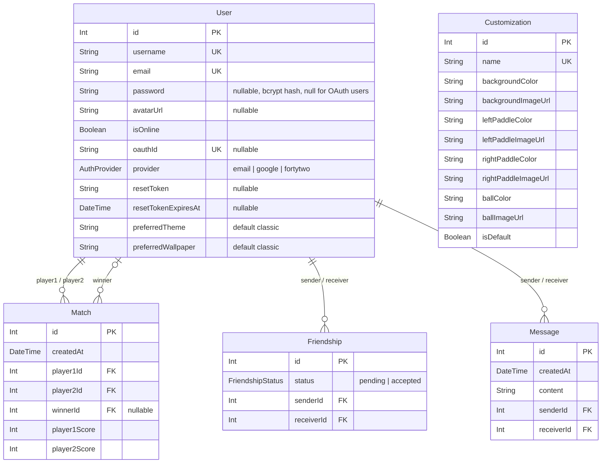

*This project has been created as part of the 42 curriculum by jmeouchy, rdennaou.*

# PONG_XP

## Description

**PONG_XP** is a full-stack web application built around a real-time, online multiplayer version of the classic **Pong** game, wrapped in a nostalgic **Windows XP-style desktop** interface.

Users create an account (email/password or Google), customize their profile, add friends, chat with them, invite them to a match or join the matchmaking queue, and play Pong live against another player on a different computer. Every match is recorded, so players can review their match history and statistics and compare themselves with others on a leaderboard.

The game is **server-authoritative**: the backend runs the physics (ball movement, collisions, scoring, power-ups) and broadcasts the game state to both players through WebSockets. The frontend only sends paddle input and renders what the server sends.

### Key Features

- Sign up / log in with email and password (hashed and salted with bcrypt), or with Google (OAuth 2.0).
- Forgot-password flow with an emailed, time-limited reset link.
- Editable profile: username, password, avatar upload (with a default avatar).
- Public profile pages with game statistics.
- Friends: send, accept, reject and remove friend requests, with live online/offline status.
- Real-time direct chat between friends.
- Real-time online Pong between two remote players:
  - random matchmaking queue, or a direct invite to a friend (accept / reject / cancel / timeout),
  - reconnection within a 15-second grace period if a player drops,
  - rematch requests,
  - random power-ups (big paddle, small paddle, freeze, small ball, paddle speed boost),
  - selectable game themes (classic, football, space),
  - a selectable max score (3, 5, 7 or 11 points) when inviting a friend.
- Match history with a chart, personal statistics (wins, losses, win rate, rank) and a global leaderboard.
- Windows XP-inspired UI: desktop, taskbar, start menu, draggable-looking windows, sounds, wallpapers.
- Responsive layout for desktop and mobile.
- Privacy Policy and Terms of Service pages, reachable from the desktop and the start menu.
- Everything served over HTTPS through a Caddy reverse proxy, started with a single Docker command.

---

## Instructions

### Prerequisites

| Tool | Version used | Notes |
| --- | --- | --- |
| Git | any recent | to clone the repository |
| Docker | 24+ | with the Docker Compose plugin (`docker compose`) |
| Google Chrome | latest stable | the supported browser |
| A Supabase project | — | provides the PostgreSQL database and the avatar storage bucket |
| A Google Cloud OAuth client | — | for "Sign in with Google" |
| A Gmail account with an app password | — | for password-reset emails |

Node.js does not need to be installed on the host: everything runs inside the containers (Node 20+, Next.js 16, React 19, Express 5, Prisma 6, Socket.IO 4).

### 1. Clone the repository

```bash
git clone <repository-url> transcendence
cd transcendence
```

### 2. Configure the environment

Copy the template and fill in your own values:

```bash
cp .env.example .env
```

| Variable | Purpose |
| --- | --- |
| `DATABASE_URL` | PostgreSQL connection string (Supabase transaction pooler), used by the app. |
| `DIRECT_URL` | PostgreSQL connection string (Supabase session pooler), used by Prisma migrations. |
| `SUPABASE_URL` | URL of the Supabase project (avatar storage). |
| `SUPABASE_SERVICE_ROLE_KEY` | Service role key, used by the backend to upload avatars to the public `avatars` bucket. |
| `JWT_SECRET` | Secret used to sign login tokens. |
| `SESSION_SECRET` | Secret for the session used during the Google OAuth handshake. |
| `GOOGLE_CLIENT_ID` / `GOOGLE_CLIENT_SECRET` | Google OAuth 2.0 credentials. Authorized redirect URI: `https://localhost:8443/api/auth/google/callback`. |
| `EMAIL_USER` / `EMAIL_PASS` | Gmail address and app password used to send password-reset emails. |
| `BACKEND_URL` | Public URL of the API, e.g. `https://localhost:8443/api`. |
| `FRONTEND_URL` | Public URL of the site, e.g. `https://localhost:8443` (also the only CORS origin allowed). |

`.env` is listed in `.gitignore` and must never be committed.

### 3. Create the database tables (first run only)

The schema lives in `backend/prisma/schema.prisma`. Apply the migrations and seed the default game themes:

```bash
docker compose run --rm backend sh -c "npx prisma migrate deploy && npx tsx prisma/seed.ts"
```

### 4. Start the application

```bash
docker compose up --build
```

This single command builds and starts the three containers:

| Service | Role |
| --- | --- |
| `caddy` | HTTPS reverse proxy, the only port exposed to the host (8443) |
| `frontend` | Next.js app (port 3000, internal only) |
| `backend` | Express + Socket.IO server (port 3001, internal only) |

Then open **https://localhost:8443** in Chrome.

- `/` → frontend
- `/api/*` → backend REST API (interactive docs at `https://localhost:8443/api/api-docs`)
- `/socket.io/*` → backend WebSockets (`wss://`)

Port 8443 is used instead of 443 because rootless Docker cannot publish ports below 1024.

To stop the application: `docker compose down`.

### Trusting the local HTTPS certificate

For `localhost`, Caddy signs the certificate with its own local CA, so the browser shows a warning until that CA is trusted. To remove the warning, export the root certificate and import it into your system's trusted root authorities:

```bash
docker compose exec -T caddy cat /data/caddy/pki/authorities/local/root.crt > caddy-root.crt
```

On a real domain, replace `localhost` in the `Caddyfile` with the domain and Caddy obtains a Let's Encrypt certificate automatically.

### Troubleshooting

If Docker reports `permission denied` on the generated Prisma client:

```bash
sudo chown -R $USER:$USER backend/generated/
```

---

## Team Information

| Member | Role(s) | Responsibilities |
| --- | --- | --- |
| **jmeouchy** | Product Owner, Project Manager, Frontend Developer | Defined the product vision and the XP look and feel, prioritized features, kept the task list up to date, validated finished features. Built the frontend: pages, components, game interface and modals, invitation flow, chat, friends and profile UI, sounds. |
| **rdennaou** | Technical Lead / Architect, Backend Developer | Chose the stack and designed the architecture (server-authoritative game, Caddy, Docker, Supabase). Built the backend: database schema, REST API, authentication, Socket.IO server, game engine, matchmaking and reconnection. Reviewed integration between frontend and backend and owned the socket event contract (`SOCKET_EVENTS.md`). |

Both members are developers: each wrote code, tested their own features and the integrated application, and documented their work.

---

## Project Management

### Work organization

- The project was split into a **frontend track** (jmeouchy) and a **backend track** (rdennaou), with integration work done together.
- Features were broken into small tasks and tracked in a shared task list kept in the repository (`TODO.md`), with a section per member and a "To test" section.
- The interface between the two tracks was written down before implementation: the socket events and their payloads are documented in `SOCKET_EVENTS.md`, the REST endpoints in Swagger (`/api/api-docs`), and the shared game types in `shared/game_types.ts`, which both the frontend and the backend import.
- Work was committed directly to `main` and pulled frequently. Each change was tested locally, then the integrated app was tested with two browser sessions to reproduce real two-player interactions.

### Tools

- **Git / GitHub**: version control and collaboration.
- **`TODO.md`**: shared task board (who does what, what remains to test).
- **`SOCKET_EVENTS.md`, Swagger**: contracts between frontend and backend.

### Communication

- **WhatsApp** for daily coordination, quick questions and reporting blockers.
- In-person work sessions for planning and for features that touched both sides (authentication, invitations, matchmaking, reconnection).

---

## Technical Stack

### Frontend

| Technology | Why |
| --- | --- |
| **Next.js 16 (App Router) + React 19** | Component model and ecosystem; file-based routing gives one route per XP "window" (`/game`, `/profile`, `/friends`, …). |
| **TypeScript** | Static typing for components, API data and socket payloads, shared with the backend. |
| **SCSS + CSS Modules** | Scoped component styles; the XP theme needs precise, hand-tuned styles (bevels, gradients, title bars). |
| **Tailwind CSS 4** | Utility classes for layout and responsiveness. Its theme is mapped onto the same design tokens as the SCSS (`styles/_tokens.scss`), so the palette is defined once. |
| **HTML5 Canvas** | Renders the Pong game from the state the server sends. |
| **socket.io-client** | Real-time connection to the backend. |
| **Axios** | HTTP client; adds the login token to every request. |
| **Recharts** | Match history chart on the game stats page. |

### Backend

| Technology | Why |
| --- | --- |
| **Node.js + Express 5** | Simple, widely documented HTTP framework; same language (TypeScript) as the frontend. |
| **Socket.IO** | Rooms (each match is a room, so state is broadcast only to its two players), automatic reconnection and connection-state recovery. |
| **Prisma ORM** | Type-safe queries, migrations and a generated TypeScript client from one schema file. |
| **jsonwebtoken (JWT)** | Stateless login tokens, sent with each API request and on socket connection. |
| **bcrypt** | Password hashing with a per-password salt. |
| **Passport + passport-google-oauth20** | "Sign in with Google". |
| **Nodemailer** | Password-reset emails through Gmail. |
| **Multer** | Receives avatar uploads before they are sent to Supabase Storage. |
| **swagger-jsdoc + swagger-ui-express** | Interactive API documentation. |

### Database

**PostgreSQL**, hosted on **Supabase**, accessed through **Prisma**.

A relational database fits the data: users, friendships, matches and messages are all linked to each other, and statistics (wins, losses, win rate, rank) are computed with relational queries over the `Match` table instead of being duplicated. Supabase gives a managed PostgreSQL instance plus a storage bucket for avatars, without running a database container.

### Infrastructure

| Technology | Why |
| --- | --- |
| **Docker Compose** | Starts the whole stack with one command, with the same environment on every machine. |
| **Caddy** | The single HTTPS entry point. Creates and renews TLS certificates automatically (including for `localhost`), and routes `/api` and `/socket.io` to the backend and everything else to the frontend. |

### Architecture

```text
                    ┌─────────────────────┐
                    │       Browser       │
                    └──────────┬──────────┘
                               │ HTTPS / WSS (port 8443)
                    ┌──────────▼──────────┐
                    │    Caddy (proxy)    │
                    └────┬───────────┬────┘
                 /       │           │  /api/*, /socket.io/*
             ┌───────────▼───┐   ┌───▼───────────────┐
             │   Frontend    │   │      Backend      │──── Google OAuth
             │ Next.js/React │   │ Node.js / Express │──── Gmail (password reset)
             │ TS / SCSS     │   │ Socket.IO         │──── Supabase Storage (avatars)
             └───────────────┘   └─────────┬─────────┘
                                           │ Prisma ORM
                                 ┌─────────▼─────────┐
                                 │    PostgreSQL     │
                                 │    (Supabase)     │
                                 └───────────────────┘
```

Only Caddy is reachable from the host. Traffic between Caddy and the containers, and between the backend and the database, stays inside the backend and is not exposed to the browser.

---

## Database Schema

Source of truth: [`backend/prisma/schema.prisma`](backend/prisma/schema.prisma).



| Table | What it stores |
| --- | --- |
| **User** | Account and profile. `password` is empty for Google sign-ins, which use `oauthId` + `provider` instead. `resetToken` / `resetTokenExpiresAt` back the forgot-password flow. `preferredTheme` holds the `name` of a Customization theme. |
| **Match** | One finished game: both players, both scores, the winner and the date. Statistics and match history are computed from this table. |
| **Friendship** | A friend request from `sender` to `receiver`; `status` goes from `pending` to `accepted`. Rejecting a request or removing a friend deletes the row. |
| **Message** | A direct chat message between two users. Messages older than 7 days are deleted automatically. |
| **Customization** | A game theme (colors / images for the background, paddles and ball). Seeded with `classic`, `football` and `space`. |

**Relationships**

- **User → Match** (1‑to‑many, three relations): a user appears in many matches as `player1` or `player2`, and optionally as `winner`.
- **User → Friendship** (1‑to‑many, two relations): each friendship links exactly one `sender` and one `receiver`.
- **User → Message** (1‑to‑many, two relations): each message links exactly one `sender` and one `receiver`.
- **User → Customization**: no foreign key; `User.preferredTheme` stores a `Customization.name`.

Login sessions are not stored in the database (authentication uses JWTs). Live online status is tracked in memory by the backend from open socket connections.

---

## Features List

| Feature | Description | Frontend | Backend |
| --- | --- | --- | --- |
| Registration / login / logout | Email + password accounts, validated on both sides (username length, password ≥ 8 chars with a letter and a digit, unique email/username). | jmeouchy | rdennaou |
| Google sign-in | OAuth 2.0 with Google; creates the account on first login. | jmeouchy | rdennaou |
| Forgot / reset password | Emailed reset link with an expiring token. | jmeouchy | rdennaou |
| Profile | View own and other users' profiles with stats; change username, password and avatar; default avatar. | jmeouchy | rdennaou |
| Avatar upload | Type/size checks, stored in Supabase Storage, can be removed. | jmeouchy | rdennaou |
| Friends | Search users, send / accept / reject requests, remove friends, friends list. | jmeouchy | rdennaou |
| Online status | Live online/offline dot, driven by socket connections. | jmeouchy | rdennaou |
| Chat | Real-time direct messages between friends, with history. | jmeouchy | rdennaou |
| Matchmaking | Random queue; a user already in a game cannot queue or be invited. | jmeouchy | rdennaou |
| Game invitations | Invite a friend; accept / reject / cancel / 30-second timeout; invites received on any page. | jmeouchy | rdennaou |
| Real-time Pong | Server-authoritative physics broadcast to both players, rendered on a canvas; first to 5 wins by default. | jmeouchy | rdennaou |
| Disconnection / reconnection | Match pauses for 15 s when a player drops; they can rejoin, otherwise the match is abandoned and the opponent wins. | jmeouchy | rdennaou |
| Rematch | Both players can request a rematch at the end of a match. | jmeouchy | rdennaou |
| Power-ups | Random power-ups announced 2 s before they apply. | jmeouchy | rdennaou |
| Max score setting | The inviter picks 3, 5, 7 or 11 points (5 by default); the friend sees it in the invite, it's validated on the server and kept for rematches. Random matchmaking always uses 5. | jmeouchy, rdennaou | rdennaou |
| Game themes & wallpapers | Choose a game theme and a desktop wallpaper, saved per user. | jmeouchy | rdennaou |
| Match history & stats | Match list, chart, wins / losses / win rate / rank. | jmeouchy | rdennaou |
| Leaderboard | Podium and ranking table of all players. | jmeouchy | rdennaou |
| XP design system | Reusable XP components, tokens, icons, sounds. | jmeouchy | — |
| Legal pages | Privacy Policy and Terms of Service. | jmeouchy | — |
| HTTPS & deployment | Caddy reverse proxy, Docker Compose. | — | rdennaou |
| API documentation | Swagger UI for every endpoint. | — | rdennaou |

---

## Modules

### Point summary

| # | Module | Type | Points | Who |
| --- | --- | --- | ---: | --- |
| 1 | Web: frameworks for frontend and backend (Next.js/React + Express) | Major | 2 | both |
| 2 | Web: real-time features with WebSockets (Socket.IO) | Major | 2 | both |
| 3 | Web: user interaction (chat, profiles, friends) | Major | 2 | both |
| 4 | User Management: standard user management and authentication | Major | 2 | both |
| 5 | Gaming: complete web-based game (Pong) | Major | 2 | both |
| 6 | Gaming: remote players | Major | 2 | both |
| 7 | Web: ORM for the database (Prisma) | Minor | 1 | rdennaou |
| 8 | Web: custom-made design system (XP components) | Minor | 1 | jmeouchy |
| 9 | User Management: game statistics and match history | Minor | 1 | both |
| 10 | User Management: remote authentication with OAuth 2.0 (Google) | Minor | 1 | both |
| 11 | Gaming: game customization options | Minor | 1 | both |
| | **Total** | 6 Major + 5 Minor | **17** | |

14 points are required; the 3 extra points are presented as bonus.

### 1. Frameworks for frontend and backend — Major (2)

- **Why:** a real component framework and a real HTTP framework let us structure a large app instead of hand-rolling routing and state.
- **How:** the frontend is a Next.js App Router project (React components, file-based routes, context providers for auth, alerts and game invites). The backend is an Express 5 app split into routers (`backend/routes/auth.ts`, `users.ts`, `friendships.ts`, `messages.ts`, `customization.ts`) with shared middleware for JWT auth.

### 2. Real-time features with WebSockets — Major (2)

- **Why:** online play, presence, invitations and chat all need the server to push updates instantly.
- **How:** Socket.IO on the backend (`backend/src/server.ts`, `game.ts`, `online.ts`), authenticated with the JWT on connection. Each match is a room, so game frames are broadcast only to its two players. Disconnections are handled gracefully: online status updates when a user's last socket closes, a dropped player gets 15 s to reconnect, and listeners are cleaned up on unmount on the frontend. Event names and payloads are documented in `SOCKET_EVENTS.md`.

### 3. User interaction — Major (2)

- **Why:** a multiplayer game is better with friends you can talk to and challenge.
- **How:** **chat** — direct messages saved through the API and delivered live over sockets (`messages.ts`, `frontend/app/chats`). **Profiles** — `/profile` and `/profile/[id]` show user info and stats. **Friends** — search, send / accept / reject requests, remove friends, friends list (`friendships.ts`, `frontend/app/friends`).

### 4. Standard user management and authentication — Major (2)

- **Why:** players need a persistent identity across matches.
- **How:** users can update their username and password, upload or remove an avatar (default avatar otherwise; uploads go through Multer to Supabase Storage), add friends and see their online status, and have a profile page. Passwords are hashed and salted with bcrypt; sessions are JWTs. A forgot-password flow sends an expiring reset link by email.

### 5. Complete web-based game — Major (2)

- **Why:** Pong is the core of the project.
- **How:** two players play a live match. The backend runs the game loop (ball movement, collisions, scoring, first to 5 points wins by default) and emits the state; the frontend draws it on an HTML5 canvas and sends only up/down input. Rules are shown in an in-game rules window, and the match ends with a game-over screen and a recorded result.

### 6. Remote players — Major (2)

- **Why:** players are on different computers, so latency and disconnects must be handled.
- **How:** the server is authoritative, so both clients always render the same state. If a player disconnects, the match pauses and the opponent sees an "opponent disconnected" window; the player has **15 seconds** to reconnect and resume (Socket.IO connection-state recovery + room rejoin). If they do not, the match is abandoned, the opponent wins and both are notified (`game_abandoned`). A user already in a match cannot start or be invited to a second one, even from another tab.

### 7. ORM — Minor (1)

- **Why:** type-safe database access and versioned migrations.
- **How:** Prisma schema in `backend/prisma/schema.prisma`, migrations in `backend/prisma/migrations`, seed in `backend/prisma/seed.ts`, generated client used throughout the backend.

### 8. Custom-made design system — Minor (1)

- **Why:** the XP identity needed to be consistent on every page, so we built our own components instead of using a UI kit.
- **How:** design tokens (color palette, typography, spacing, radii) in `frontend/app/styles/_tokens.scss`, exposed as CSS variables and mapped into Tailwind. Reusable components in `frontend/app/components/ui` and around it, including `XPWindow`, `XPModal`, `XPCard`, `XPGroupBox`, `XPListPanel`, `XPAlert`, `XPLoader`, `XPSkeleton`, `XPStatusDot`, `AuthButton`, `AuthField`, `AuthPanel`, `DesktopIcon` and `StartMenuItem`, plus a set of XP icons and sounds. Components are documented in `STYLING_NOTES.md`.

### 9. Game statistics and match history — Minor (1)

- **Why:** gives players a reason to keep playing and a way to track progress.
- **How:** stats computed from the `Match` table: wins, losses, win rate and rank. The game stats page shows the match history (date, opponent, score, result) with a progression chart (Recharts), and a leaderboard with a podium and a ranking table.

### 10. OAuth 2.0 remote authentication — Minor (1)

- **Why:** lets users sign in without creating a new password.
- **How:** Passport with the Google OAuth 2.0 strategy (`backend/src/OAuth.ts`). On callback the backend finds or creates the user (`provider = google`), issues a JWT and redirects to the frontend, which stores it and logs the user in.

### 11. Game customization — Minor (1)

- **Why:** variety and personalization.
- **How:** **power-ups** — every 10–15 s a random power-up (big paddle, small paddle, freeze, small ball, paddle speed boost) is announced, then applied for a few seconds. **Themes** — classic (default), football and space, each defining background, paddle and ball colors/images, stored in the `Customization` table and saved per user. Desktop wallpapers can also be changed. **Game settings**: when inviting a friend, the inviter chooses the max score of the match (3, 5, 7 or 11 points). The friend sees it in the invite before accepting, the server only accepts values from the allowed list, and a rematch keeps the same score. **Defaults**: the classic theme and a max score of 5, which random matchmaking always uses.

---

## Individual Contributions

### jmeouchy — Product Owner, Project Manager, Frontend Developer

- **Product & UI direction:** chose the Windows XP concept, designed the desktop, taskbar, start menu and window layouts, picked wallpapers, icons and sounds.
- **Authentication pages:** login, register, forgot/reset password, Google sign-in redirect and error pages, with client-side validation.
- **Game interface:** game page, canvas rendering, match selection, matchmaking / waiting states, friend selection, invite request and incoming invite windows, rules, game over, rematch and opponent-disconnected windows, power-up indicators, customization window.
- **Invitations outside the game page:** a global invite context and popup so invitations are received on any page.
- **Social pages:** profile (own and others'), account actions, change username / password / avatar windows, friends page (add, requests, list), chat page.
- **Statistics pages:** match history list, stats and chart; leaderboard podium, table and personal stats.
- **Legal pages:** Privacy Policy and Terms of Service.
- **Desktop extras (easter eggs):** extra desktop apps that make the XP desktop feel alive, with nods to *The Hitchhiker's Guide to the Galaxy*:
  - **Marvin**: an "answer machine" where you ask Marvin, the Paranoid Android, a question; after a short "thinking" state he replies with a random, suitably gloomy answer.
  - **Deep Thought**: choose "The Answer to Life, the Universe, and Everything" (an animated progress bar "estimated at 7,500,000 years" that ends on **42**) or "The Ultimate Question" (which stalls at 99.8% and fails with *Error 404: Earth not found*).
  - **Paint**: an XP window embedding [JS Paint](https://jspaint.app), a web remake of MS Paint, with a loading screen.
- **Challenges:** a single user action can produce several asynchronous socket events, so modal states, matchmaking states and navigation had to stay consistent without stale state; this was solved by centralizing game socket handling in hooks (`UseGameSockets`, `UseGameInvite`) and cleaning up listeners on unmount. Receiving invitations while not on the game page required moving invite handling out of the game page into a global context.

### rdennaou — Technical Lead / Architect, Backend Developer

- **Architecture & infrastructure:** chose the stack; set up Docker Compose, the Caddy HTTPS reverse proxy (single entry point on 8443) and the Supabase database and storage.
- **Database:** designed the Prisma schema, migrations and the theme seed.
- **REST API:** auth (register, login, logout, Google OAuth, forgot / reset / change password), users (profile, search, leaderboard, match history, username, avatar upload/removal), friendships, messages, customization; server-side validation on every endpoint; Swagger documentation.
- **Security:** bcrypt password hashing, JWT authentication for HTTP and sockets, CORS restricted to the frontend origin, secrets moved to `.env`.
- **Real-time server:** Socket.IO presence tracking, chat delivery, matchmaking queue, friend invitations with timeout, busy-player checks.
- **Game engine:** server-authoritative game loop, collisions and scoring, power-up scheduling, 15-second reconnection grace period and abandonment, rematches, saving match results.
- **Challenges:** keeping the game fair between two remote clients was solved by running the physics only on the server. Reconnection was the hardest part: a player can drop, reconnect in another tab, or both players can leave; timers for the grace period and the power-ups had to be tracked per room and always cleared, so a paused match is either resumed or cleanly abandoned.

---

## Resources

### Documentation

- Next.js — https://nextjs.org/docs
- React — https://react.dev/
- TypeScript — https://www.typescriptlang.org/docs/
- Node.js — https://nodejs.org/docs/latest/
- Express — https://expressjs.com/
- Socket.IO — https://socket.io/docs/v4/
- Prisma — https://www.prisma.io/docs
- PostgreSQL — https://www.postgresql.org/docs/
- Supabase — https://supabase.com/docs
- Docker — https://docs.docker.com/
- Caddy — https://caddyserver.com/docs/
- Passport Google OAuth 2.0 — https://www.passportjs.org/packages/passport-google-oauth20/
- Tailwind CSS — https://tailwindcss.com/docs

### Assets

- User account pictures: [Windows HD User Account Picture Pack](https://www.deviantart.com/windowsaesthetics/art/Windows-HD-User-Account-Picture-Pack-843341713)
- Paint app: [JS Paint](https://jspaint.app) by Isaiah Odhner, embedded in an iframe
- Marvin and Deep Thought: inspired by Douglas Adams' *The Hitchhiker's Guide to the Galaxy*

### AI usage

AI assistants were used as a helper, never as a replacement for understanding the code. Every suggestion was reviewed, adapted, tested and can be explained by the team member who integrated it.

AI was used for:

- **Learning:** explaining unfamiliar concepts (Socket.IO rooms and connection-state recovery, Next.js App Router, Prisma relations, JWT and OAuth flows, Caddy).
- **Debugging:** TypeScript, React and Next.js errors; Socket.IO listener and lifecycle issues (duplicate listeners, stale state); Docker and permission issues.
- **Reasoning about real-time flows:** invitation accept / reject / timeout, matchmaking states, opponent disconnection and reconnection, preventing busy players from being invited.
- **Review and refactoring:** suggestions on component organization and state management.
- **Documentation:** structuring and proofreading this README and the code comments.

---

## Known Limitations

- The database is a hosted Supabase instance, so the app needs internet access and a configured Supabase project.
- Real-time play depends on a stable network connection; a disconnection longer than 15 seconds ends the match.
- Chat messages older than 7 days are deleted automatically.
- Only Chrome (latest stable) is officially supported.

## License

Created for educational purposes as part of the 42 curriculum.
