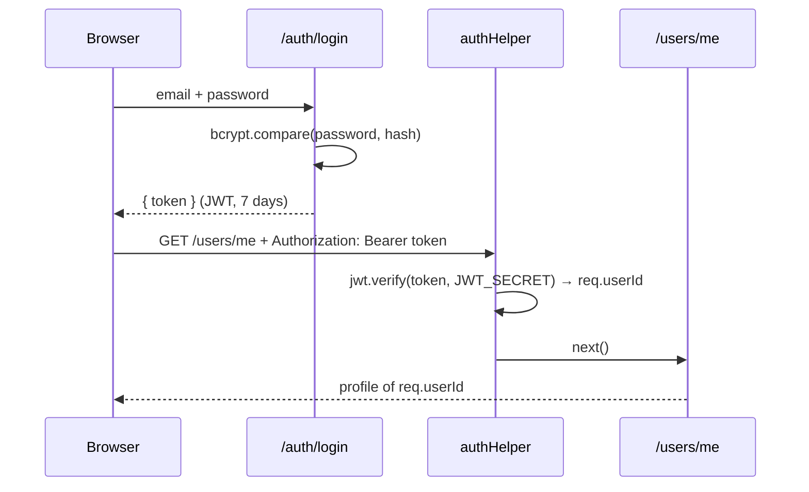

Worth fixing before the defense

Some inputs aren't validated. PATCH /customization/me/wallpaper saves any value, and themeName or ?q= given as a non-string give a 500 instead of a 400. This contradicts "server-side validation on every endpoint" in your README.
Small fixes

The resetBall comments are wrong. They say the ball is sent "toward the loser", but the code sends it toward the player who scored. Decide which you want and make the code and comments agree.
Unused code: the jwt import in users.ts, the express-session package, SESSION_SECRET in the README's .env table, and the database's isOnline column. An evaluator might ask what they do.
When both players drop, the second disconnect overwrites the first grace timer. The player who dropped second then "wins" after 15 s, and one timer is never cancelled.
Power-ups keep counting down while the game is paused, so an effect can run out during a disconnect.


Design choices to be ready to explain (fine for this project, but evaluators like to ask)

The Google login puts the JWT in the redirect URL (/auth/callback?token=...), so it ends up in the browser history.
There's no rate limit on login, so passwords can be guessed by brute force.
Forfeits aren't saved to match history.
Any logged-in user can list anyone's friends (GET /friendships/:userId).
A page reload can't rejoin a running match. Only short network drops recover it. The main README's "reconnect in another tab" line should be corrected.

# Backend: how it works

A guide to the backend code: what each file does, how a request or a game moves through it, and why it's built that way.

It doesn't repeat the other docs:

| For | See |
| --- | --- |
| Setup, `.env`, stack choices, database schema | [`../README.md`](../README.md) |
| Every socket event and its payload | [`../SOCKET_EVENTS.md`](../SOCKET_EVENTS.md) |
| Every REST endpoint, with "Try it out" | Swagger at `https://localhost:8443/api/api-docs` (generated from the `@swagger` comments in `routes/`) |
| Game constants and shared types | [`../shared/game_types.ts`](../shared/game_types.ts) |

---

## 1. The big picture

The backend is **one Node.js process** that runs two things on the same HTTP server, port 3001:

- **Express**: the REST API (accounts, profiles, friends, messages, themes).
- **Socket.IO**: the real-time part (online status, chat delivery, matchmaking, invites, the game itself).

```text
Browser ──HTTPS──▶ Caddy :8443 ──┬── /api/*        ──▶ backend :3001  (Express, "/api" stripped)
                                 ├── /socket.io/*  ──▶ backend :3001  (Socket.IO)
                                 └── everything else ──▶ frontend :3000
```

Caddy strips the `/api` prefix, so the browser calls `/api/users/me` but Express sees `/users/me`. That's why the routes in the code have no `/api`.

Only Caddy is reachable from the host. Port 3001 is exposed on the Docker network only.

**Where state lives:**

| Kind of data | Where | Survives a backend restart? |
| --- | --- | --- |
| Users, matches, friendships, messages, themes | PostgreSQL (Supabase), through Prisma | Yes |
| Avatar images | Supabase Storage, public `avatars` bucket | Yes |
| Who is online, the queue, invites, running games | In memory, in plain `Map`s and objects | **No** |

Live state is kept in memory because it changes 60 times per second and is only useful while the server runs. Writing it to the database would be slow and pointless. The cost is that a restart ends every running game, and the app can only run as one instance. Several instances would need a shared store such as Redis.

---

## 2. File map

```text
backend/
├── src/
│   ├── server.ts          entry point: Express setup, Socket.IO setup, ALL socket event handlers
│   ├── game.ts            game engine: game loop, physics, scoring, power-ups, pause/resume
│   ├── OAuth.ts           Passport "Sign in with Google" strategy
│   ├── prisma.ts          the shared Prisma client (+ avatar URL fix-up)
│   ├── io.ts              holds the Socket.IO server so routes can emit events
│   ├── online.ts          onlineUsers map: userId → set of connected socket ids
│   ├── urls.ts            FRONTEND_URL / BACKEND_URL / JWT_SECRET from .env
│   └── helpers/
│       ├── auth_helpers.ts    authHelper middleware (JWT check) + password/username rules
│       ├── game_helpers.ts    pending invites, "is this user busy?", match reservation
│       └── upload_helpers.ts  avatar upload to / delete from Supabase Storage
├── routes/                REST endpoints, one Express Router per area
│   ├── auth.ts            /auth/*          register, login, Google, forgot/reset/change password
│   ├── users.ts           /users/*         profile, stats, match history, search, leaderboard, avatar
│   ├── friendships.ts     /friendships/*   send / accept / reject / list
│   ├── messages.ts        /messages/*      send a message, load a conversation
│   └── customization.ts   /customization/* game themes and wallpaper
├── prisma/
│   ├── schema.prisma      database schema (source of truth)
│   ├── migrations/        SQL migrations generated from the schema
│   └── seed.ts            creates the classic / football / space themes
├── scripts/               one-off maintenance scripts (wipe users, wipe matches, move old avatars)
└── generated/prisma/      Prisma client generated from the schema (don't edit, regenerated at startup)
```

**Why `io.ts` exists:** `POST /messages` has to push the new message to the recipient's socket. Routes can't import `server.ts`, because `server.ts` imports the routes, and that would create an import cycle. So `server.ts` stores the Socket.IO server with `setIo()`, and routes fetch it with `getIo()`.

---

## 3. What happens at startup

[`src/server.ts`](src/server.ts) runs top to bottom:

1. **Loads `.env`.** [`urls.ts`](src/urls.ts) throws if `JWT_SECRET` is missing. The server refuses to start rather than fall back to a hardcoded secret that anyone reading the source could use to forge tokens.
2. **Creates the Express app:** CORS restricted to `FRONTEND_URL`, a JSON body parser, then mounts each router (`/auth`, `/users`, `/friendships`, `/customization`, `/messages`).
3. **Attaches Socket.IO** to the same HTTP server, with the same CORS rule and `connectionStateRecovery` turned on (see [§9](#9-disconnects-and-reconnection)).
4. **Serves Swagger** at `/api-docs`, built from the `@swagger` comments in `routes/*.ts`.
5. **Starts message cleanup:** deletes chat messages older than 7 days, once at startup and then every 24 h.
6. **Registers the socket middleware and handlers** (`io.use(...)`, `io.on("connection", ...)`).

In Docker, the container runs `prisma generate` and then `tsx watch src/server.ts`, so the server restarts by itself when a file changes.

---

## 4. Authentication

### How a logged-in user is recognised

Logins are **JWTs** (JSON Web Tokens), not server sessions. After a successful login the backend signs a token containing `{ userId, username }` with `JWT_SECRET`. It's valid for **7 days**. The frontend stores it and sends it back on every call.

- **REST:** the frontend sends `Authorization: Bearer <token>`. Protected routes run the [`authHelper`](src/helpers/auth_helpers.ts) middleware first. It verifies the signature and expiry, then puts the user's id on `req.userId`. If the token is missing or invalid it answers `401` and the route never runs.
- **Sockets:** the frontend connects with `io(url, { auth: { token } })`. The `io.use(...)` middleware in `server.ts` verifies the same token and stores `userId`, `username` and `avatarUrl` on `socket.data`. Without a valid token, the connection is refused.

The server **never trusts a user id sent by the client**. "Who is this?" always comes from the verified token. That's what stops someone from acting as another user by changing an id in a request.



### The flows ([`routes/auth.ts`](routes/auth.ts))

| Flow | What happens |
| --- | --- |
| **Register** | Validates the email format (`name@domain.tld`), the username (3–20 chars, trimmed) and the password (8–72 chars, at least one letter and one number). Checks the email and username aren't taken. Hashes the password with **bcrypt, 12 rounds**, creates the user, and returns a token, so the user is logged in right away. |
| **Login** | Finds the user by email and compares the password with `bcrypt.compare`. Accounts created with Google have no password and get a "use Google" message instead. |
| **Google** | `GET /auth/google` sends the browser to Google. Google redirects back to `/auth/google/callback`. The Passport strategy in [`OAuth.ts`](src/OAuth.ts) then finds the user by email or creates one, making the Google display name unique by adding random digits if needed. The backend signs a JWT and redirects to the frontend's `/auth/callback?token=...`. If the email already belongs to an email/password account, it redirects to `/login?error=google_email_exists` instead of merging the two accounts. |
| **Forgot password** | Generates 32 random bytes as a reset token, valid **1 hour**, saves it on the user, and emails a link through Gmail (Nodemailer). The answer is the same whether or not the email exists, so this form can't be used to find out which emails are registered. |
| **Reset password** | Looks up a user whose token matches and hasn't expired, saves the new hash, and **clears the token** so the link works only once. |
| **Change password** | Logged-in only. Asks for the current password first, so a stolen open session can't change it silently. |
| **Logout** | Nothing to do on the server, because JWTs aren't stored there: the frontend deletes its token. |

**Emails are case-insensitive:** register, login, forgot-password and Google sign-in all trim and lowercase the email (`normalizeEmail`) before using it. So `Rawan@x.com` and `rawan@x.com` are the same account, and logging in works whatever capitals you type.

**Why 72 characters max:** bcrypt silently ignores everything after 72 bytes. Without the limit, two different long passwords with the same first 72 bytes would both work.

---

## 5. The REST API

The full list, with request and response shapes, is in Swagger. What matters for understanding it is **who may do what**:

| Area | Rules enforced by the server |
| --- | --- |
| **Profiles** `GET /users/:id` | You and your friends get the full profile, including email and online status. Anyone else only gets username, avatar and game stats. |
| **Search** `GET /users/search?q=` | Case-insensitive "contains" match on usernames, at most 10 results, never includes yourself. |
| **Stats** `/users/me`, `/users/:id` | Computed live from the `Match` table (wins = matches where you're the winner, losses = played − wins). Nothing is stored twice, so it can't get out of sync. |
| **Leaderboard** `GET /users/leaderboard?scope=all\|friends` | The database counts wins and matches per user with `groupBy`. Players are ranked by the **lower bound of the Wilson score interval** of their win rate rather than the raw win rate. Otherwise a player with 1 win out of 1 match (100%) would outrank one with 45 out of 50 (90%). |
| **Avatar** `POST/DELETE /users/me/avatar` | Multer keeps the file in memory: JPEG/PNG/WEBP/GIF only, 5 MB max. It's uploaded to Supabase Storage and the public URL is saved on the user. The previous file is deleted. |
| **Friendships** | Only the **receiver** can accept a request. Either side can reject or remove one, which deletes the row. You can't add yourself, send a duplicate, or send a request back to someone who already sent you one. Only you can list your own pending requests. |
| **Messages** | You can only message **accepted friends**, up to 2000 characters. `GET /messages/:friendId` returns 30 messages by default (100 max), and `?before=<id>` loads older ones. |
| **Customization** | Themes are rows in the `Customization` table, seeded by `prisma/seed.ts`. Saving a theme checks that it exists. If the saved one is gone, the default theme is used. |

Each route checks its input before touching the database: ids are integers, strings aren't empty, values come from an allowed list. It answers `400` (bad input), `403` (not allowed), `404` (not found) or `500` (unexpected error, details only in the server log).

### Two small race-condition guards

Some actions are a "check, then create" pair of queries. Two identical requests arriving at the same moment, like a double-click, could both pass the check before either one creates anything. Two in-memory sets stop that:

- `pairsInProgress` in [`friendships.ts`](routes/friendships.ts): the pair `lowerId:higherId` is locked while a friend request is being created, so A→B and B→A at the same moment can't both succeed.
- `startingMatch` in [`game_helpers.ts`](src/helpers/game_helpers.ts): see [§7](#7-starting-a-match).

### `prisma.ts`: the avatar URL fix-up

Older avatars were stored as relative paths (`/uploads/avatars/x.png`). A Prisma `$extends` rule rewrites `avatarUrl` on **every read** of a user, adding the current `BACKEND_URL` in front, so old and new avatars both come out as full URLs. Every route gets this automatically.

---

## 6. Real-time: sockets, presence and chat

### What happens when a socket connects

1. The `io.use` middleware verifies the JWT and fills `socket.data` (see [§4](#4-authentication)).
2. `connection`: the socket is recorded in `socketToUser` (socket id → user id) and in `onlineUsers` (user id → *set* of socket ids).
3. If this is the user's **first** socket, every client gets `online_changed { isOnline: true }`.
4. If Socket.IO recovered an interrupted session, the game is resumed (see [§9](#9-disconnects-and-reconnection)).

**Why a set of sockets per user:** one person can have several tabs or devices open. Each one is a separate socket. A user goes offline only when their **last** socket disconnects, so closing one tab doesn't show them offline to friends.

`online_changed` is sent only when the status actually flips, not on every connect or disconnect. The REST API answers "is X online?" from the same `onlineUsers` map with `isUserOnline()`, without a database query. The `isOnline` column in the database isn't used anymore.

### Chat

Messages are **sent with REST** (`POST /messages`), which validates the message, checks the two users are friends and saves it. The socket only **delivers** it: right after saving, the route emits `receive_message` to every socket of the recipient. If the recipient is offline, nothing is pushed, and they load the conversation with `GET /messages/:friendId` next time.

Saving through REST means one validated path for every message, and it works even if the recipient isn't connected.

---

## 7. Starting a match

There are three ways a match starts, all in [`server.ts`](src/server.ts). They end the same way: both sockets join a Socket.IO **room** named `match-<n>`, both get `match_found`, and `startGame()` starts the engine.

A room is a named group of sockets: `io.to(room).emit(...)` sends only to the players of that match.

### Random matchmaking (`join_queue`)

The queue is a single variable, `waitingPlayer`.

- If nobody is waiting, this socket becomes `waitingPlayer` and gets `waiting`.
- If someone is waiting, and it's a **different user**, the two are matched. A second tab of the same account gets `already_waiting`, so you can't play yourself.
- If the user is already playing, in any tab, the request is ignored.

### Friend invite (`invite_friend` → `invite_response`)

Pending invites are kept in `pendingInvites` ([`game_helpers.ts`](src/helpers/game_helpers.ts)), keyed by `"inviterId:inviteeId"`. Each entry has a 30-second timeout and the chosen max score (3, 5, 7 or 11).

Before sending an invite, the server refuses if: the score isn't allowed, you invite yourself, either player is already in a game, the friend is offline, or either side already has a pending invite. The one-invite-at-a-time rule avoids a case where two friends both accept and only one match can start.

The invite is cancelled automatically when it times out, the inviter cancels it, the inviter disconnects, or either player starts another match.

### Rematch (`request_rematch`)

`rematches` stores, per finished room, which sockets asked. When both have asked, a new room is created **with the same max score** as the previous match. That score is kept in `roomWinningScores`. A rematch is refused if a player has left the result screen, disconnected, or started another game.

### The "busy" check and match reservation

`isUserBusy(userId)` returns true if any of the user's sockets is in a running game.

There's a gap between "these two will play" and "the game exists": the server first awaits the players' current avatars from the database. During that wait, another invite could be accepted, and the same player could end up in two matches. To prevent it:

```text
reserveMatch(a, b)   → mark both busy right away + cancel their other invites
await avatars
startGame(...)       → from now on, the running game keeps them busy
releaseMatch(a, b)
```

The queue is cleared **before** the await for the same reason.

---

## 8. The game engine

Code: [`src/game.ts`](src/game.ts).

### Server-authoritative

**The server is the only one that runs the game.** The ball, collisions, scores and power-ups are all computed on the server. Clients send only `paddle_move { room, direction }` and draw whatever `game_state` says.

That keeps the game fair: a modified client can't move the ball or change the score. It also keeps both players in sync, because there is only one copy of the truth.

### Per-room state

Everything is keyed by room name:

| Object | Holds |
| --- | --- |
| `games[room]` | The full game state: ball position and speed, paddles, scores, the two players' socket ids, current paddle sizes and speeds, power-up state |
| `gameIntervals[room]` | The running 60 fps loop. **No entry means the game is paused.** |
| `powerUpTimers[room]` | The timer for the next power-up |
| `disconnectTimers[room]` | The 15 s grace-period timer, if a player dropped |

### The game loop

`startGame()` creates the state, sets a **3-second countdown**, and starts `runGameLoop()`, a `setInterval` running **60 times per second**. Each tick:

1. `updateGame()`. During the countdown the ball doesn't move. Otherwise:
   - moves the ball by its speed;
   - bounces it off the top and bottom walls;
   - on a paddle hit: reverses the horizontal direction, puts the ball back in front of the paddle so it can't get stuck inside, speeds it up by **5%** (capped at **2.5×** the starting speed), and emits `paddle_hit` for the sound;
   - if the ball passes a side: the other player scores and the ball is reset to the centre;
   - if a player reaches the winning score: ends the match (below).
2. Sends `game_state` to the room.

**Paddles** move a fixed step for each `paddle_move` event and are kept inside the field. The server checks that the sender is really one of that room's players, because the room name comes from the client. A frozen paddle ignores moves.

### Power-ups

The first one comes after the countdown, then one every **10–15 s** at random:

```text
pick a random type + a random side ("the collector")
   ↓  power_up_incoming   (2 s warning)
apply the effect
   ↓  power_up_activated
5 s later (3 s for freeze)
   ↓  power_up_expired     → sizes/speeds back to normal
```

| Type | Effect |
| --- | --- |
| `bigPaddle` | Collector's paddle ×2 tall |
| `smallPaddle` | Opponent's paddle ½ tall |
| `freeze` | Opponent's paddle can't move (3 s only, so it stays fair) |
| `smallBall` | Ball ½ size |
| `paddleSpeedBoost` | Collector's paddle moves 1.5× faster |

While the game is paused, new power-ups are skipped and an announced one waits until the game resumes.

### End of a match

When someone reaches the winning score:

1. `isEnding` is set first. Two ticks can overlap because `updateGame` is async, and this makes sure the end runs only once.
2. The loop and power-up timer are stopped and `games[room]` is deleted.
3. The match is **saved to the `Match` table** without waiting for the result, so `game_over` isn't delayed by the database.
4. `game_over` is sent with the winner and the scores.

The usernames for `game_over` are fetched during the countdown (`usernamesPromise`), so they're ready instantly at the end.

---

## 9. Disconnects and reconnection

A dropped connection doesn't end the match straight away.

**When a player's socket disconnects** (`disconnect` handler in `server.ts`):

1. It's removed from `onlineUsers`. If it was the user's last socket, everyone gets `online_changed { isOnline: false }`.
2. Its invites are cleaned up: invites it sent are cancelled, and invites sent to a user with no sockets left count as declined.
3. It's removed from the queue.
4. If it was in a game: the loop is **paused** (`pauseGame`), the opponent gets `player_disconnected`, and a **15-second grace timer** starts (`scheduleGameCleanup`).

**Then one of three things happens:**

| What happens | Result |
| --- | --- |
| The player **reconnects** within 15 s | Socket.IO's `connectionStateRecovery` restores the *same* socket id and rooms (`socket.recovered`). The server cancels the timer, resumes the loop and sends `player_reconnected`. |
| The 15 s **run out** | The remaining player wins: `game_over` with `reason: "disconnect"`, and the game is deleted. |
| The remaining player clicks **Leave Game** (`leave_game`, or `join_queue`) | `abandonPausedGame()` drops the match right away, with no winner. |

Recovery only works for a short connection drop, such as a network blip or a laptop waking up. A **page reload** opens a brand-new socket with a new id. That socket isn't one of the match's players, so it can't rejoin, and the match ends when the grace period runs out.

Matches that end by disconnect aren't saved to the database. Only matches won on score appear in the history and stats.

---

## 10. Security summary

| Threat | What the backend does |
| --- | --- |
| Stolen database → stolen passwords | Only bcrypt hashes are stored: salted, 12 rounds, 72-byte limit |
| Forged login | JWTs signed with `JWT_SECRET`. The server won't start without it, and tokens expire after 7 days |
| Acting as another user | The user id always comes from the verified token, never from the request. Ownership checks on friendships and messages answer 403 |
| Unauthenticated sockets | The socket handshake requires the same JWT |
| SQL injection | All queries go through Prisma, which uses parameterized queries. There's no hand-written SQL |
| Account discovery | Forgot-password gives the same answer whether or not the email exists |
| Reset-link reuse | The reset token is random (32 bytes), expires after 1 h and is cleared after use |
| Other websites calling the API | CORS allows only `FRONTEND_URL`, for both REST and sockets |
| Eavesdropping | Everything goes over HTTPS/WSS through Caddy. The backend port isn't exposed to the host |
| Malicious uploads | Image MIME types only, 5 MB max, stored on Supabase rather than the server's disk |
| Cheating in the game | The server runs the physics and only accepts paddle moves from that match's two players |
| Secrets in git | All keys are in `.env`, which is in `.gitignore` |

---

## 11. Working on the backend

All commands run inside the container (`docker compose exec backend <command>`), because `node_modules` lives there:

| Task | Command |
| --- | --- |
| Type-check | `npx tsc --noEmit` |
| Change the schema | edit `prisma/schema.prisma`, then `npx prisma migrate dev --name <what_changed>` |
| Look at the data | `npx prisma studio` |
| Re-seed themes | `npx tsx prisma/seed.ts` |
| Delete all matches / all users | `npx tsx scripts/deleteAllMatches.ts`, `npx tsx scripts/deleteAllUsers.ts` |
| Follow the logs | `docker compose logs -f backend` (from the host) |

When you add an endpoint, add a `@swagger` comment above it so it shows up in `/api-docs`. When you add a socket event, add it to [`SOCKET_EVENTS.md`](../SOCKET_EVENTS.md).
